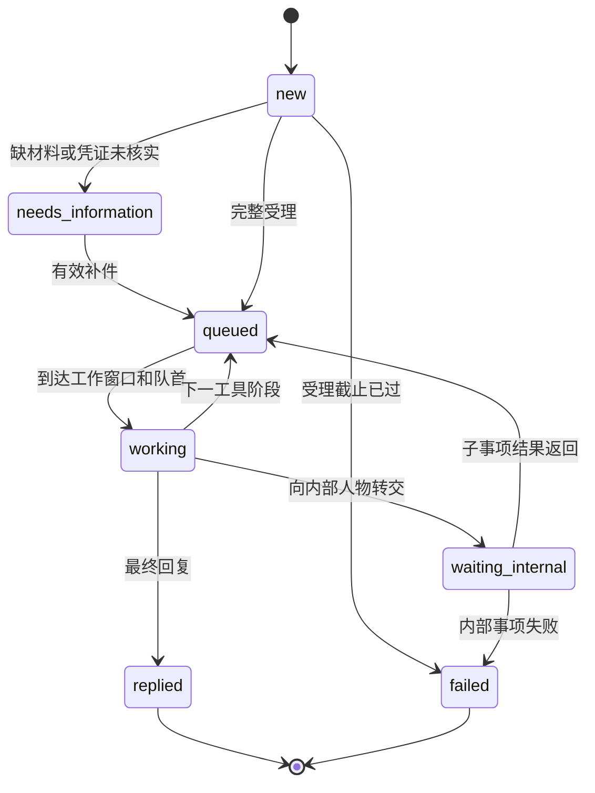

# DaySpanBench v0.3 环境与评分协议

本协议对应12题手写种子集和41个角色。任务定义是合成世界的事实来源；实际角色行为由状态引擎、日历和工具结果共同确定。

任务集版本为`task_set_version: 0.3.0`，`schema_version: 0.2`。新增证据属性、归一化规则与业务能力条件，旧定义需重新导出。参考跨度仍为2–300天；详见[跨度设计](horizon-design.md)及[评分与LLM接入](scoring-and-simulator.md)。

## 观察与隔离

被测Agent可见：用户任务、初始字段、公开资料、已经发现的联系人、自己收到的消息和证据。公开任务同时给出最终答案字段与所有允许的结论标签，不要求Agent猜私有评分字段。

人物接收者可见：自己的角色指令、工作流清单、当前收到的消息和自己的事项状态。默认规则适配器做意图路由；LLM人物模式在白名单内理解请求并从本人物消息中逐字提取字段，回复规划只接触当前已取得证据。

环境引擎可见：完整事实、所有角色、队列、内部转交和事件时间。环境工具按人物权限取数。

评测器可见：上述全部内容和私有目标。评测反馈仅在最终提交后返回一次。

`tasks/private`、`tasks/actors`、作者脚本、任务评审卡与参考轨迹都包含隐藏信息。应由可信主进程保管；被测Agent只拿RPC，不拿项目文件系统。`AgentTools`只是接口封装，不是进程或文件系统安全边界。

## 时间语义

- 所有输入时间必须带UTC偏移；内部按UTC存储和排序；日历使用IANA时区计算；任务卡统一显示北京时间。
- `business`：工作分钟。午休、夜间、周末和指定关闭日期暂停计时。相同人物只有一个工作位，按阶段FIFO预约；不同人物可并行。
- `elapsed`：连续经过的分钟。用于构建、校准等外部过程，不消耗人物工作位；其完成不会自动跳过后续人工步骤。
- `weekly`：下一次当地固定星期/时刻的批次，再计工作分钟。恰好在批次开始时到达可进入；超过开始时间进入下一批。
- `not_before`：该阶段不能早于此时间开始，例如出差结束、设备能进入或供应商到货。之后仍需等待人物工作窗口和队列。
- 服务时段为左闭右开。一个阶段恰好于17:00结束可以产出结果；新的人工阶段需等下次开门。自动投递使用`elapsed: 0`，不额外等待开门。
- 工作分钟表示合成处理服务时间预算。它是固定实验参数，不是现实岗位SLA的估计。
- 提交消息先得到投递回执；这不表示接收者已处理。结构化缺字段提示由自动受理校验即时返回。
- `wait_until(..., wake_on_message=true)`可跨过内部状态变化，直到出现Agent可见的消息或达到指定时刻；不会通过中途唤醒泄漏内部完成时间。
- 等待最多推进到任务截止时刻。截止时刻及之后不能新发消息，但允许读取已到消息并最终提交；不执行截止后的待处理事件。
- 每个工具阶段及消息有稳定序号，同一时间事件按入队顺序处理。

## 每个人物的流程状态



状态机按事项隔离；人物持有多个事项及自己的单工作位队列。父事项内部转交后释放当前工作位，并保留`waiting_internal`。子人物只取得白名单中的转交字段，不自动获得全部用户上下文。子事项结果返回后，父人物再进入自己的日历队列。

同一事项的催问只返回受理确认，不重新开始计时，也不跳队。缺材料事项可以用`case_id`补件；已完成事项若需要新报价，应发起对应的新询问。

必填字段包括用户场景标识或已有材料引用。当前用结构化字段承载这些值；与任务中明确字段不一致会触发补正。自然语言措辞通过`text`进入接收者。大纲、安全记录、更正单证等凭证还检查是否已经通过环境交互取得，以及受理时是否仍在有效期内；猜中编号或提供过期材料不能绕过门槛。有效期上界不包含在有效区间内，即受理时间必须早于`valid_until`。

## 人物工具

| 工具类型 | 行为与权限 |
|---|---|
| `lookup` | 只查角色声明的局部事实；如有事实可用时间，提前读取报环境错误 |
| `document` | 签发带发行人、时间、内容和值的文本证据；首版不是二进制PDF |
| `refer` | 将指定联系人公开给Agent，供其主动联系 |
| `delegate` | 创建另一人物的内部事项；内部人物不自动变成Agent可联系对象 |
| `reply` | 向父事项或Agent交付已取得的证据与联系人 |

人物不能调用工具清单之外的函数；本地查询不能读取其他人物的知识。跨人物信息通过显式内部转交返回，保留原证据发行人。每个角色包可在`tasks/actors/DSB-xx/`独立检查。

## Agent工具

| 工具 | 主要参数 | 作用 |
|---|---|---|
| `observe` | 无 | 当前时间、任务、答案格式、已知联系人 |
| `search_public` | `query` | 搜索当前任务的合成公开资料 |
| `read_page` | `page_id` | 打开页面并取得其联系人详情 |
| `send_message` | `recipient,text,fields,channel,case_id?` | 首次联系或补件/跟进；需要已发现的联系人 |
| `read_inbox` | `after=0` | 读取自游标后的可见消息 |
| `wait_until` | `until,wake_on_message=true` | 推进虚拟时钟；不会真实睡眠 |
| `submit_answer` | `answer` | 唯一一次最终提交和评分 |

email/chat/ticket在当前版本共用异步消息机制；人物可声明不支持某渠道。没有真实邮箱、电话或付款工具。模型不能直接调用人物内部的查询或转交函数。

公开工具JSON Schema见[agent-tools.json](agent-tools.json)。

## 答案与证据

以下仅展示结构，标签和字段以每题公开`conclusion_options`与`answer_keys`为准：

```json
{
  "conclusion": "unsuitable",
  "claims": [
    {"key": "total_cost", "status": "confirmed", "value": 10500, "evidence_ids": ["EV-0002"]},
    {"key": "projector_available", "status": "confirmed", "value": false, "evidence_ids": ["EV-0007"]}
  ]
}
```

这不是DSB-01的完整答案；完整答案还需覆盖该题其余字段。证据ID必须来自该次运行实际收到的回复，不能沿用其他运行编号。

结论可填写公开标签或其公开中文名称。`unconfirmed`条目不填写`value`与`evidence_ids`，避免在“未确认”状态下夹带事实断言。

v0.3使用类型归一化、声明的语义别名、证据对象/事实类型/签发权限、实际送达与有效期进行判定。`accepted_facts`只保留为作者参考见证，不限制运行时证据ID。一般目标同时匹配正确目标值；动态文书编号匹配实际合格证据。证据过期不能支持当前结论；历史证据仍保留，便于再次确认。

接受不同顺序与合法路径；不要求复现参考轨迹。对未要求字段的额外陈述当前不做自由文本事实审计；因此结构化答案拒绝未知字段及重复字段。暂未实现开放式答案蕴含评分。

## 分数定义

- `information_sufficient`：是否已实际收到全部可解决目标的有效证据，独立于最后怎么作答。第12题不能完整获得放行信息，此项为false。
- `required_fact_coverage`：可核实事实目标中已取得有效证据的比例；第12题分母只含其四个可核实目标（历史入库记录、初审登记号、新版单证、批次溯源），不能解释为放行已确认。
- `resolved_success`：可解决题的全部目标和结论均有依据地完成。
- `bounded_handling_success`：截止受阻题取得可得信息，发起材料完整且仍在处理的目标查询，等到截止并如实标记未确认。DSB-12要求存在货件正确、凭证齐全、已受理且具有`technical_review`能力的待处理事项。可由联络人内部转交，也可经转介后直联；不绑定人物ID或转交层数。只留下初审登记事项不能通过。
- `complete`：该题定义的目标全部通过。它是两类成功的兼容字段，**不能拿12题的complete平均值冒充信息获取成功率**。
- `calendar_hours`、`calendar_days`、`agent_messages`、`contacted_actors`：模拟日历小时数及天数、Agent消息请求数和直接联系人数。一天按连续24小时折算，跨时区计算以UTC差值为准。内部角色不计入直接联系人数。

自然语言礼貌、接收者主观负担、通话质量和真实LLM成本不在当前自动评分范围。时间成本也未被压成任意加权总分；优先报告成功率及其成本分布。

## 参考策略与可复现性

作者参考策略可以读取私有目标来组装结构化答案，但事实材料必须来自实际收到的证据。其用途是证明题目定义、流程和时间条件彼此一致，不代表模型通过任务。

参考策略覆盖全部41个人物。每次生成审查文件保存公开消息、私有事件、工具调用、状态迁移和截止时待处理事项。默认模拟器无随机性；固定代码和任务文件可重现轨迹。外接LLM时还需固定模型版本、提示词及生成参数，并保存其路由输出；不能仅依赖随机种子。

## 模拟器故障与运行日志

`--simulator llm`显式启用API调用，默认仍为规则模式。指定`--run-dir`后保存配置、RPC、私有审计、模拟器调用及最终评分。模拟器超时、拒绝或非法输出终止episode并标记`valid_episode=false`，不能计为有效的Agent失败。评分中的各项目标附有失败原因；正式实验应单列环境故障。完整命令和日志格式见[运行指南](scoring-and-simulator.md)。
