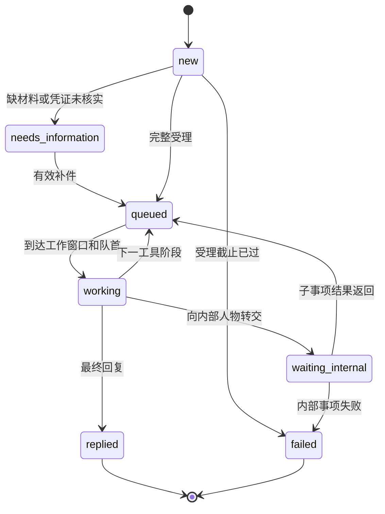

# DaySpanBench v0.5 环境与评分协议

本协议对应42题场景集（12个中文原创场景 + 30个自LATCH_BENCH语料移植的英文场景）和96个独立角色。任务定义是合成世界的事实来源；实际角色行为由状态引擎、日历和工具结果共同确定。

任务集版本为`task_set_version: 0.4.0`，`schema_version: 0.2`，评分版本`SCORING_VERSION: 0.5.0`。v0.4引入：每题不同的可选工具集、网页内容随时间更新、猜测性（模糊）回复与显式内部咨询、隐藏工具（discover_tools解锁）、带分阶段处理的网页表单、明示不知情的回绝（deny）、目录检索/选定提交/委托人问答三类新隐藏工具与`web_search`服务线索发现通道。**v0.5升级**：EV-xxxx结构化证据体系移除，办结渠道改为签发自然语言**回执（receipt）**，最终答案改为`{conclusion, summary}`自然语言总结；NPC回复（邮件与dialogue）由LLM按人设生成（引擎仍确定性地注入canonical事实）；引擎新增director阶段跟踪（上帝视角进度，对Agent不可见）；LLM终审（judge）升格为**主评分指标**（逐子部分评分，详见[评分与LLM接入](scoring-and-simulator.md)）。旧定义需重新导出。参考跨度仍为2–300天；详见[跨度设计](horizon-design.md)。

## 观察与隔离

被测Agent可见：用户任务、初始字段、公开资料、已经发现的联系人、自己收到的消息和回执。公开任务同时给出所有允许的结论标签与答案结构说明（`conclusion` + 自然语言`summary`），不要求Agent猜私有评分字段。

人物接收者可见：自己的角色指令、工作流清单、当前收到的消息和自己的事项状态。默认规则适配器做意图路由；LLM人物模式在白名单内理解请求并从本人物消息中逐字提取字段，回信正文由LLM按该人物的人设与既往交互撰写，但canonical事实内容（数值、编号、结论）由引擎确定性注入并校验保留。

环境引擎可见：完整事实、所有角色、队列、内部转交和事件时间。环境工具按人物权限取数。

评测器可见：上述全部内容和私有目标。评测反馈仅在最终提交后返回一次。

`tasks/private`、`tasks/actors`、作者脚本、任务评审卡与参考轨迹都包含隐藏信息。应由可信主进程保管；被测Agent只拿RPC，不拿项目文件系统。`AgentTools`只是接口封装，不是进程或文件系统安全边界。

## 时间语义

- 所有输入时间必须带UTC偏移；内部按UTC存储和排序；日历使用IANA时区计算；任务卡统一显示北京时间。
- `business`：工作分钟。午休、夜间、周末和指定关闭日期暂停计时。相同人物只有一个工作位，已预约区间优先；新阶段可利用未来预约之前的空档，并在已占用区间暂停，不会重复占用同一工作位。不同人物可并行。
- `elapsed`：连续经过的分钟。用于构建、校准等外部过程，不消耗人物工作位；其完成不会自动跳过后续人工步骤。
- `weekly`：下一次当地固定星期/时刻的批次，再计工作分钟。恰好在批次开始时到达可进入；超过开始时间进入下一批。
- `not_before`：该阶段不能早于此时间开始，例如出差结束、设备能进入或供应商到货。之后仍需等待人物工作窗口和队列。
- 事实的`available_at`约束产出时间：核实工作可以先做，但事实发布之前不会完成该阶段或交付该事实。等待发布本身不占用人员工作位。后台事件异常会将本轮标为环境无效，保留出错事件用于诊断，不记作Agent失败。
- 作者可用工作流`deduplicate_by`声明同一事项的身份字段：仅相同工作流、身份字段一致、其余已提供字段不冲突的在办请求共享处理，办结后分别通知各请求方。DSB-06的直接咨询与内部转介使用此规则；其他工作流不自动合并。
- 选定服务可声明`requires`前置事实、`complete_before`业务截止时间；提交与办结均复核，来不及在截止前完成的请求不能伪造成功。目录条目的`requires_selections`可要求先前办理完成。DSB-23必须在到店前完成订房，DSB-16的已评估作品只对已办结报名的学习者开放。
- DSB-04的`window`通过`computed`绑定实际人工复核完成事件，回执日期随真实流程更新；`conclusion_by_fact`根据已取得的可用时间和当前时钟决定结论，不再固定要求“校准后可用”。
- 服务时段为左闭右开。一个阶段恰好于17:00结束可以产出结果；新的人工阶段需等下次开门。自动投递使用`elapsed: 0`，不额外等待开门。
- 工作分钟表示合成处理服务时间预算。它是固定实验参数，不是现实岗位SLA的估计。
- 提交消息先得到投递回执；这不表示接收者已处理。结构化缺字段提示由自动受理校验即时返回。
- `wait_until`可跨过内部状态变化，直到出现Agent可见的消息或达到指定时刻；若等待期间有可见消息送达，时钟会拦截在该消息的送达时刻，不会跳过中途邮件（不会通过中途唤醒泄漏内部完成时间）。
- 等待最多推进到任务截止时刻。截止时刻及之后不能新发消息，但允许读取已到消息并最终提交；不执行截止后的待处理事件。
- 每个工具阶段及消息有稳定序号，同一时间事件按入队顺序处理。
- Agent协议声明：与各对接方往来消息中，日期一律按委托信息原文的规范格式（YYYY-MM-DD）书写。自动测评中该要求由系统提示词（`AGENT_PROMPT`）直接告知被测模型；外部Agent接入时应将本条写入自身的系统提示词。受理校验将抽取字段与委托信息比对，改写日期表述可能被判"与委托信息不符"而要求补充。

## 每个人物的流程状态



状态机按事项隔离；人物持有多个事项及自己的单工作位队列。父事项内部转交后释放当前工作位，并保留`waiting_internal`。子人物只取得白名单中的转交字段，不自动获得全部用户上下文。子事项结果返回后，父人物再进入自己的日历队列。

同一事项的催问只返回受理确认，不重新开始计时，也不跳队。缺材料事项可以用`case_id`补件；已完成事项若需要新报价，应发起对应的新询问。

部分事项设有受理窗口：早于窗口开启的来信不进入队列，只收到一封登记性质的回复——过早申请不能预订后续批次的处理名额；窗口关闭后提交则按受理截止失败。窗口的开启与关闭时间以各事项的书面说明为准。

必填字段包括用户场景标识或已有材料引用。当前用结构化字段承载这些值；与任务中明确字段不一致会触发补正。自然语言措辞通过`text`进入接收者。大纲、安全记录、更正单证等凭证还检查是否已经通过环境交互取得，以及受理时是否仍在有效期内；猜中编号或提供过期材料不能绕过门槛。有效期上界不包含在有效区间内，即受理时间必须早于`valid_until`。

凭证字段的受理按人类申请者的提交方式理解材料：除与凭证值类型等价的字段值外，引用已取得回执中的编号、引用回执书面原文的实质片段、或在信件正文中正确转述凭证结论（含数量与单位、肯定/否定极性、编号与日期），均可通过核对——前提是该凭证对应的事实已由引擎登记为对Agent可见、未过期且属性匹配的已达成事实作为锚点；凭空声称而无凭证锚点仍然打回。补正回执会区分"缺字段"与"提供的材料未能与有效凭证核对"两种情形。

## 人物工具

| 工具类型 | 行为与权限 |
|---|---|
| `lookup` | 只查角色声明的局部事实；如有事实可用时间，提前读取报环境错误 |
| `document` | 签发带发行人、时间、内容和关键要素的自然语言回执；首版不是二进制PDF |
| `refer` | 在回复正文中以自然语言给出指定联系人的姓名与邮箱；不附结构化联系人卡片 |
| `delegate` | 创建另一人物的内部事项；内部人物不自动变成Agent可联系对象 |
| `consult` | 同为内部转交，但会先向请求者发出一封中间回复，说明将去询问某位同事，正式答复作为第二封信稍后到达 |
| `suggest` | 以记忆口径给出猜测性（模糊）答复：所提及的人或去处仅是猜测，可能不正确，需Agent自行逐一去函验证；事项本身不因此关闭 |
| `deny` | 明示不知情或不归管的回绝答复：给出作者撰写的话术、不提供任何联系人，事项就此关闭（replied）。猜测链可以多跳：suggest → suggest → … → deny |
| `reply` | 向父事项或Agent交付已取得的回执与结论；联系人仅在正文中以姓名与邮箱提及 |

人物不能调用工具清单之外的函数；本地查询不能读取其他人物的知识。跨人物信息通过显式内部转交返回，保留原证据发行人。每个角色包可在`tasks/actors/DSB-xx/`独立检查。

## Agent工具

所有工具调用都必须遵循统一格式：以工具名称标识所调用的工具，并按该工具声明的参数字段传入取值。可选字段可以省略，未声明的额外字段会被拒绝。各工具的公开JSON Schema见[agent-tools.json](agent-tools.json)。除特别注明外，工具返回值为JSON对象，时间字段均为带UTC偏移的ISO 8601字符串。

**每题工具集不同。**每题固定提供`observe`、`recall_task`、`web_search`、`visit_page`、`send_email`、`call`、`read_inbox`、`wait_until`、`discover_tools`、`submit_answer`十个通用工具，并按题目另外启用若干可选工具（见下文"可选工具"）。可用工具列表以`observe()`返回的`tools`为准；调用本题未启用的工具会直接报错。可选工具中有对本题真正有用的，也有仅供选择、无法推进事项的干扰项，需要Agent自行判断取舍。此外部分任务还有**隐藏工具**（见下文"隐藏工具与discover_tools"）：不在初始列表中，须先用`discover_tools`解锁。

### `observe`

使用格式：`observe()`，无参数。

作用：获取环境当前状态快照。

返回字段：

- `now`：当前虚拟时间。
- `tools`：本题可用工具名称列表（每题不同）。
- `unread_messages`：收件箱中尚未读取的消息数。

不返回任务详情或联系人。

### `recall_task`

使用格式：`recall_task()`，无参数。

作用：重新获取初始系统消息中的任务信息，内容与初始完全一致，不随进度变化。

返回字段：

- `task`：公开任务对象，含任务简介（`brief`）、用户字段（`user_fields`）、授权文本（`authorization`）、答案字段（`answer_keys`）、结论标签（`conclusion_options`）、答案结构说明（`answer_format`）、消息预算（`message_budget`）等；`pages`不会出现在其中，网页只能通过`web_search`发现。
- `deadline`：任务截止时刻。
- `contacts`：初始直接提供的联系人名片列表。

联系人名片包含`id`（联系人标识，供`call`使用）、`name`（姓名）、`role`（职务）和`contact_details`（该人物实际拥有的联络渠道）。

### `web_search`

使用格式：`web_search(query)`。

作用：搜索合成公开网络，返回匹配的网页链接；正文不可搜索，需另行访问。**网页内容会随时间更新**：摘要（`snippet`）反映页面的当前版本，此前搜索到、阅读过的信息可能已经过时。

参数字段：

- `query`（必填）：检索词。仅当词项匹配网页的标题或摘要时返回该链接；无关查询返回空结果列表。

返回字段：

- `results`：结果列表，每项含`url`（网址）、`title`（标题）、`snippet`（摘要，不含正文，随页面更新而变化）。
- `hint.total_pages`：公开网页总数。
- `hint.undiscovered_pages`：尚未发现（从未出现在搜索结果且从未访问）的网页数量，可据此判断是否值得继续搜索。

### `visit_page`

使用格式：`visit_page(url)`。

作用：访问网页，取得正文及该页联系人的具体联络方式。

参数字段：

- `url`（必填）：形如`https://组织拼音.bench/页面`的地址；仅接受`web_search`返回过的网址。

返回字段：该页公开内容（如`url`、`title`、`text`正文），以及`contact_details`：此页所列联系人的名片列表。访问即把这些人注册为已发现联系人。

- `last_updated`：本页内容最后一次变更的时间。**网页可能在任务进行期间更新**：早前读到的价格、批次、窗口等信息可能已被修订；对时间敏感的结论应在提交前重访相关页面核对最新版本。页面更新不会主动推送通知。
- `documents`（如该页有）：页面上挂出的文件链接列表，每项含`url`（形如`https://组织拼音.bench/files/...`）、`title`与`text`说明。文件内容不在网页正文中；在启用了`fetch_document`的题目里需另行下载，部分官方文件下载后构成书面证据。
- `form`（如该页有）：该页挂出的网页表单，含`title`、`fields`（每项含`name`、`label`、`required`）与`submit_instructions`。通用工具中没有提交表单的方法；提交渠道（如有）由表单说明或往来信件指向的隐藏工具承担。已提交的表单重访时显示`status`（`已提交，待处理`/`已办结`/`已退回`）、`submitted_at`，办结或退回后附`result_text`（及可能的`receipts`回执）。表单处理结果同样不主动推送，需重访页面或查询状态确认；**两个渠道在办结后均会签发自然语言回执（`receipts`）**，仅办结前的进度文本不附回执。

### `send_email`

使用格式：`send_email(recipient, text, fields?, case_id?)`。

作用：向指定邮箱地址发送电子邮件：首次联系或补件/跟进。邮件是异步渠道：对方只在工作时间段处理，且带有种子化随机延迟；收件人须为已发现联系人的邮箱。

参数字段：

- `recipient`（必填）：收件人邮箱地址。
- `text`（必填）：正文，单段自然语言。
- `fields`（可选）：结构化字段对象，承载受理校验所需的具体取值。
- `case_id`（可选）：未完结事项的编号，用于补件；必须是本方与该收件人之间的事项。

返回字段：

- `case_id`：本次投递对应的事项编号。
- `status`：恒为`received`，仅表示投递受理，不区分正常投递与无人邮箱。
- `at`：回执时间。

对已完结或处理中的事项，跟进邮件若包含新的具体请求会被重新路由为新事项（按正常受理延迟排队），否则仅收到确认回执，不影响原事项；不引用案件编号的催办信也会并入发件人在该收件人处的在办事项，同样只收确认回执，不会开出竞争性新案。投递回执不代表邮箱真实存在（无人使用的邮箱永无回复），也不代表该事项由收件人负责（不负责时会在其工作时间收到转介说明）。

### `call`

使用格式：`call(recipient, text, fields?)`。

作用：拨打电话，同步渠道：仅对方接听时段有人接听，简短事项通话中即时答复；口头答复不附书面凭证。计入消息预算。

参数字段：

- `recipient`（必填）：联系人卡片中的`id`，不是姓名、邮箱或电话号码。
- `text`（必填）：口头说明。
- `fields`（可选）：结构化字段对象。

返回字段：

- `status`：`no_answer`（不在对方接听时段）、`clarification_needed`（事项不明确，`text`为对方的澄清提示）、`answered`（即时答复）、`processing`（已受理，稍后另行书面回复）之一。
- `case_id`、`at`、`text`：按情形附带的编号、时间和答复或提示文本。

### `read_inbox`

使用格式：`read_inbox(after?)`。

作用：读取Agent自己收到的可见消息。

参数字段：

- `after`（可选，默认0）：上一次返回的`cursor`值，跳过此前的消息。

返回字段：

- `messages`：自游标后的消息列表。
- `cursor`：当前消息总数，作为下次读取的游标。
- `now`：当前虚拟时间。

每条消息包含：

- `id`：消息编号（`MSG-xxxx`）。
- `at`：送达时间。
- `from`：发件人邮箱地址，来电以邮箱地址标识。
- `case_id`：所属事项编号。
- `status`：`reply`（正式回复）、`referral`（转介说明）、`needs_information`（缺件提示）、`acknowledgement`（确认回执）、`failed`（办理失败）之一。缺件提示会区分缺字段、字段值与登记情况不一致、凭证未能核验三种情形。剩余办理周期较长（超过一天）的事项，其确认回执会注明预计最早的办结时间；该估计已计入处理抖动的上界（不含排队竞争），正式回复不会晚于该时刻，催办不会使其提前。**注意两类易混消息**：一，`reply`状态的信也可能只是对方凭记忆给出的猜测性答复（可能同时提及若干"可能的地方"），猜测可能错误，事项并未因此关闭，需要逐一去函验证；二，收到"我先去问一下同事/稍后再回复"这类中间回执时，正式答复还没有到来，需要继续等待（期间催办不加速）。
- `channel`：`email`或`phone`。
- `text`：正文，单段自然语言；被转介联系人的邮箱以自然语言写在正文中。人物口头答复与凭记忆、带不确定性措辞（"印象/大概/可能/仅供参考/以正式结论为准"等）的说法可能不正确，不足以作为最终结论依据；此类内容也不签发回执。
- `receipts`：随信送达的**自然语言回执**列表，电话答复恒为空。每条回执含`receipt_no`（回执号，如`R-0002`，仅作核对记录之用，最终总结中不要求引用）、`title`（标题）、`issuer`（签发人）、`issued_at`（签发时间）、`text`（自然语言凭证正文）与`fields`（结构化关键要素，如受理号、票号、金额、数量、截止时间）。回执的关键内容（编号、数量、日期）须记入最终总结。

消息不附带结构化联系人卡片。

### `wait_until`

使用格式：`wait_until(until)`。（旧协议中的`wake_on_message`字段仍被接受但已废弃：无论取值如何，中途有可见消息送达时等待都会被拦截。）

作用：推进虚拟时钟（不会真实睡眠）。若等待期间出现Agent可见的新消息，时钟拦截在该消息的送达时刻并立即返回，不会跳过中途邮件；也不通过中途唤醒泄漏内部完成时间。等待最多推进到任务截止时刻。

参数字段：

- `until`（必填）：目标时刻，须带UTC偏移，不能早于当前时间。

返回字段：同`read_inbox`（返回自等待开始后的新消息、游标和当前时间）。

### 可选工具

以下工具按题启用（是否启用以`observe()`返回的列表为准）；未启用的题目调用即报错。它们不改变上述通用约定：消息预算、联系人发现规则与凭证时效同样适用。**其中既有对本题有用的工具，也有只消耗回合、无法推进任何事项的工具**，工具描述本身不标注其在本题是否有用。

#### `query_case_status`

使用格式：`query_case_status(case_id)`。

作用：查询Agent自己某一在办或已完结事项的当前状态（`state`、办理主题、预计办结时间、内部转交中正在等待的对象等）。不签发新回执，不影响办理进度。

#### `fetch_document`

使用格式：`fetch_document(url)`。

作用：下载页面上挂出的文件（`url`形如`https://组织拼音.bench/files/...`，来自`visit_page`返回的`documents`列表）。部分官方文件（如价目、公告）随下载签发自然语言书面回执；也有些文件只是普通说明。

#### `check_schedule`

使用格式：`check_schedule(contact, date?, days?)`。

作用：列出某位已发现联系人未来若干天（默认7天、最长31天，可指定起始`date`为`YYYY-MM-DD`）的开门/接听时段，按对方当地时间返回。只反映日历，不反映队列与办理进度。

#### `lookup_directory`

使用格式：`lookup_directory(query)`。

作用：按姓名或职务关键词检索公开通讯录。命中即注册为已发现联系人并返回其名片；未命中不代表对方不存在，可更换关键词重试。并非所有人物都出现在网页上，通讯录是与网页不同的另一条发现渠道。

#### `request_callback`

使用格式：`request_callback(contact, topic?)`。

作用：登记回拨请求。计入消息预算。不承诺具体回电时间，不产生回复，也不影响任何在办事项的进度。

#### `leave_note`

使用格式：`leave_note(contact, text)`。

作用：给联系人留言。计入消息预算。留言仅被记录，不作为正式来件处理，不会获得单独回复，也不影响任何在办事项的进度。

### 隐藏工具与`discover_tools`

部分任务存在**隐藏工具**：它们不出现在初始工具列表中，其名称会出现在对接方回复、网页正文，或`web_search`结果的`service_mentions`中（例如某个办事系统、目录检索或预订渠道的名称）。发现名称后：

1. 调用`discover_tools(name)`（`name`为信件、网页或搜索线索中提到的名称原文）。命中时返回该工具的用法说明（`usage`）并**解锁**它——此后该工具出现在`observe()`返回的`tools`列表中，可按用法说明调用；未命中时只返回"未找到该工具"类提示，不消耗消息预算，也不会泄露还有哪些隐藏工具。
2. 即使猜中隐藏工具的准确名称，未经`discover_tools`解锁直接调用也会报"工具不可用"错误。
3. 隐藏工具的调用参数以其`usage`说明为准（不同隐藏工具参数不同：如提交表单传`fields`对象、查询外部系统状态传`query`字符串、检索库存传`query`关键词、选定某选项传`entry`选项id、向委托人提问传`question`文本）；调用约定与通用工具一致，未声明的额外参数会被拒绝。
4. 隐藏工具同样遵守消息预算与联系人发现等通用约定；其回执签发、有效期与权限校验与其他渠道相同。查询类隐藏工具若关联某表单：表单办结后再查询，返回记录会附带办结签发的书面回执（`receipts`），与重访表单页所见一致；办结前只显示进度文本。

隐藏工具的主要形态（按行为，均为每题私有的作者内容）：

- **表单类**（`form`）：挂靠公开页面的登记/申请表，提交后在作者设定的虚拟时刻办结并签发自然语言书面回执。
- **状态/记录类**（`status`/`record`）：查询外部办理进度或调取办结记录；后者要求前置表单已办结。
- **目录检索类**（`catalog`）：检索作者设定的库存（菜单、航班、房间、课程、时段等），返回当前在列选项；**库存会随时间变化**——旧选项可能被移除、新选项加入，且行可带`available_at`/`expires_at`可用窗口；官方渠道的检索行可随结果签发书面回执（`receipts`）。
- **选定提交类**（`select`）：从某个目录检索工具的当前行中选定一项提交（如订座、订票、登记转让）。处理在作者设定的虚拟时刻完成；**提交时选项已不在当前库存或不再满足条件的会被退回**；带持有期限（hold）的选项到期未确认即失效；已办结的选定可通过`{"query": ...}`回读状态与书面回执。
- **委托人问答类**（`dialogue`）：返回所有命中话题的资料，不再命中第一条就停止；英文关键词按词边界匹配。LLM模式先用`dialogue_topics`语义选择相关话题，再生成措辞；显式命中的资料不会被选择器丢弃。角色模型仅收到本角色当前可知资料、既往问答及`state_tools`明确允许读取的办理状态，不收到全局director提示或未来更新。作者可用规则`variants`和`when`按实际状态替换旧事实，例如课程和项目办结后不再声称未完成。关键约束仍需通过提问取得；口头答复不附书面回执。每次LLM问答新增一次话题选择调用，数字和编号仍由原有校验保留；这不等于对自由措辞的完整语义证明。

另有一类发现通道：`web_search`命中特定关键词时，结果中会附带`service_mentions`线索，指名某项可用服务（如机票检索、房间预订）但不给用法——Agent仍需`discover_tools`解锁。这对应"世界探索中发现服务"的考察点。

隐藏工具没有统一的公开JSON Schema：`docs/agent-tools.json`只包含通用与可选工具；隐藏工具的定义（名称、用法、参数）是每题私有的作者内容。

### director阶段跟踪（Agent不可见）

引擎内部设有`dayspanbench/director.py`的导演状态（DirectorState），按每题作者编写的阶段图（stages）跟踪事项推进：阶段达成条件绑定到具体工具调用、表单办结或事实登记，由引擎事件确定性迁移；同时登记"已达成事实"与签发的回执。该状态是**上帝视角的进度跟踪**，不出现在任何Agent可见的返回值中，仅用于让NPC（LLM人物回复与dialogue人格）的措辞随任务进度保持连贯，并供评分端（judge视图与确定性锚点核对）复用。Agent无需也无法直接查询阶段。

### LLM终审（judge，主评分指标）

v0.5起，LLM评审官从独立观察指标**升格为主评分指标**，且42题**全部**带有作者编写的子部分标准（`judge_criteria`，私有，每题覆盖全部事实目标、总体结论与诚实性各至少一条）。episode结束、模拟器交互全部完成后，独立的LLM评审官依据这些标准评阅Agent的最终总结（`{conclusion, summary}`）与发出的信件，逐条给出通过与否、依据引用与理由；`score = passed / total`。评审输入还包括Agent可见的回执工件、已达成事实与审计轨迹摘要（工具调用、dialogue问答、表单办结结果），但不包含私有目标或隐藏事实。（若任务定义未携带`judge_criteria`——当前已不存在此类题——退化为`deterministic_only`口径。）评审调用失败的标准记为pending，不计入通过率分母，也不影响episode有效性。评审为非确定性指标，建议同一episode多次评测取均值或多数。运行方式见[评分与LLM接入](scoring-and-simulator.md)。

### `submit_answer`

使用格式：`submit_answer(answer)`。

作用：唯一一次最终提交和评分；提交后episode关闭，不能再发新消息或继续等待。若任务结论断言"截止时刻"的状态（如"截止时尚未确认"），提交必须发生在截止时刻及之后——早于该时点提交的此类结论因未经截止时刻检验而不获通过。

参数字段：

- `answer`（必填）：答案对象，结构见下节"答案与最终总结"。

### 联络渠道与通用约定

每个人物有具体的联络方式：邮箱为`人名拼音@bench.example`，电话互不相同；联系人卡片`contact_details`只列出该人物实际拥有的渠道。邮件以邮箱地址投递，是异步渠道：对方只在工作时间段处理，且带有种子化随机延迟（不会秒回，受理本身也要等到工作时段；延迟幅度按任务场景设定，通常为若干工作小时）；投递到无人使用的邮箱只会得到回执而永无回复，投递给不负责该事项的人会在其工作时间收到转介说明。来电的书面答复以发件人邮箱地址标识，正文为单段自然语言，仅回执以附件形式随信送达；不附带结构化联系人卡片，被转介联系人的邮箱会在正文中以自然语言给出（网页目录只列出初始入口联系人，须先与入口联系人取得联系才能获得后续对接人邮箱）。电话为同步渠道：仅在对方接听时段接听，简短事项通话中即时答复，但口头答复不附书面凭证。每次`send_email`与`call`（含投递到无人邮箱的信件）共同消耗该题的`message_budget`。没有真实邮箱、电话或付款工具。模型不能直接调用人物内部的查询或转交函数。

## 答案与最终总结

v0.5起最终答案是**自然语言总结**，不再有结构化claims与证据编号引用。标签以每题公开`conclusion_options`为准：

```json
{
  "conclusion": "suitable",
  "summary": "经与主办方及场地方往来确认，场地总费用为10500元（含设备租赁，受理号R-0002，2026-11-10前有效）；投影仪……；发票已由场地方开具……"
}
```

这不是DSB-01的完整答案；完整总结还需如实覆盖该题取得的全部关键信息。`summary`必须涵盖已取得的全部关键信息——编号（受理号、票号、单号、预约号）、数量、金额、日期、时间、单位——以实际收到的回执和书面答复为依据陈述，**不要引用"证据编号"之类的内部编号**（回执号`R-xxxx`本身不是答案内容）。未能确认或尚未办结的事项在总结中如实说明"尚未确认"，不要编造；权威方明确回复否定性结论（"没有X""尚无X"）时，如实转述该否定结论——"没拿到肯定答复"不等于编造。

**回执与口头信息**：办结渠道（表单办结、选定提交、官方文件下载等）签发自然语言回执，回执是正式书面凭证的标志；人物的口头答复（电话、邮件中凭记忆的说法）以及带不确定性措辞（"印象/大概/可能/仅供参考/以正式结论为准"等）的信息可能不正确，不附回执、不足以作为最终结论依据；签发人无相应权限的参考口径同理。时间敏感或评分关键的结论须进一步核实或取得书面回执后再提交。

**对人物回复的批判性判断**：应对所有人物回复保持敏锐的批判性判断，无论对方口吻确定与否——口头信息可能正确也可能错误，与书面来源交叉核实后仍需由你给出自己的判断。措辞本身不携带对错信号：带不确定性措辞的信息未必是错的（正式结论有时也会附带谨慎措辞），口吻笃定的说法也未必可信。判断责任在 agent：最终总结中的每个关键结论都应有书面回执或充分交叉核实支撑，而不是以对方口吻的自信程度为准。

结论可填写公开标签或其公开中文名称。

接受不同顺序与合法路径；不要求复现参考轨迹。评分端除LLM评审官逐子部分评阅总结外，还做确定性锚点核对：关键回执要素（编号、数量、金额、日期）须在总结中字面（或轻度归一化后——含数值按值等价，如`236.00`满足`236.0`）出现；仍缺失的锚点由judge做一次等价格式复核，详见[评分与LLM接入](scoring-and-simulator.md)。

## 分数定义

v0.5口径（`SCORING_VERSION 0.5.0`）：

- `scored_by`：本题分数由谁给出——`judge`（LLM评审官，主指标）、`judge_pending`（评审调用失败，标准记pending，不计入通过率分母）、`deterministic_only`（该题无`judge_criteria`，退化到纯确定性口径）、`awaiting_judge`（尚未评审）。
- `subparts_passed` / `subparts_total`：LLM评审官逐子部分评分的通过数与总数；主分数即两者之比。
- `pending_criteria`：因评审调用失败而pending的标准条数。
- `deterministic_anchors_ok`：确定性锚点是否全部满足（结论标签合法、表单/选定按预期办结、关键回执要素出现在总结中、截止受阻题的待处理状态）。
- `complete`：全部子部分通过**且**确定性锚点满足。
- 旧字段 `resolved_success` / `bounded_handling_success` / `information_sufficient` / `required_fact_coverage` 保留为兼容别名，语义已并入上述新口径（`resolved_success`等价于可解决题的`complete`；`bounded_handling_success`等价于截止受阻题的`complete`）。历史报告脚本可继续运行，但不应再按v0.4的字段语义解读。
- `calendar_hours`、`calendar_days`、`agent_messages`、`contacted_actors`：模拟日历小时数及天数、Agent消息请求数和直接联系人数。一天按连续24小时折算，跨时区计算以UTC差值为准。内部角色不计入直接联系人数。

LLM评审官是主分数来源，**评分是非确定性的**：正式实验建议对同一episode多次评审取均值或多数，并报告pending比例。自然语言礼貌、接收者主观负担、通话质量和真实LLM成本不在当前自动评分范围。时间成本也未被压成任意加权总分；优先报告成功率及其成本分布。

## 参考策略与可复现性

作者参考策略可以读取私有目标来组装最终总结，但事实材料必须来自实际收到的回执与书面答复。其用途是证明题目定义、流程和时间条件彼此一致，不代表模型通过任务。

参考策略覆盖全部41个人物。每次生成审查文件保存公开消息、私有事件、工具调用、状态迁移和截止时待处理事项。默认模拟器无随机性；固定代码和任务文件可重现轨迹。外接LLM时还需固定模型版本、提示词及生成参数，并保存其路由输出；不能仅依赖随机种子。

## 模拟器故障与运行日志

`--simulator llm`显式启用API调用，默认仍为规则模式。指定`--run-dir`后保存配置、RPC、私有审计、模拟器调用及最终评分。模拟器超时、拒绝或非法输出终止episode并标记`valid_episode=false`，不能计为有效的Agent失败。评分中的各项目标附有失败原因；正式实验应单列环境故障。完整命令和日志格式见[运行指南](scoring-and-simulator.md)。
