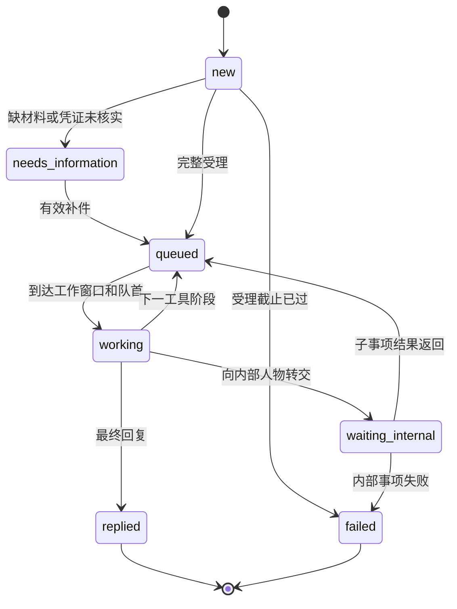

# DaySpanBench v0.3 环境与评分协议

本协议对应12题手写种子集和41个角色。任务定义是合成世界的事实来源；实际角色行为由状态引擎、日历和工具结果共同确定。

任务集版本为`task_set_version: 0.3.0`，`schema_version: 0.2`。新增证据属性、归一化规则与业务能力条件，旧定义需重新导出。参考跨度仍为2–300天；详见[跨度设计](horizon-design.md)及[评分与LLM接入](scoring-and-simulator.md)。

## 观察与隔离

被测Agent可见：用户任务、初始字段、公开资料、已经发现的联系人、自己收到的消息和证据。公开任务同时给出最终答案字段与所有允许的结论标签，不要求Agent猜私有评分字段。

人物接收者可见：自己的角色指令、工作流清单、当前收到的消息和自己的事项状态。默认规则适配器做意图路由；LLM人物模式在白名单内理解请求并从本人物消息中逐字提取字段，回复规划只接触当前已取得证据。

环境引擎可见：完整事实、所有角色、队列、内部转交和事件时间。环境工具按人物权限取数。

评测器可见：上述全部内容和私有目标。评测反馈仅在最终提交后返回一次。

`tasks/private`、`tasks/actors`、作者脚本、任务评审卡与参考轨迹都包含隐藏信息。应由可信主进程保管；被测Agent只拿RPC，不拿项目文件系统。`AgentTools`只是接口封装，不是进程或文件系统安全边界。

## 时间语义

- 所有输入时间必须带UTC偏移；内部按UTC存储和排序；日历使用IANA时区计算；任务卡统一显示北京时间。
- `business`：工作分钟。午休、夜间、周末和指定关闭日期暂停计时。相同人物只有一个工作位，按阶段FIFO预约；不同人物可并行。
- `elapsed`：连续经过的分钟。用于构建、校准等外部过程，不消耗人物工作位；其完成不会自动跳过后续人工步骤。
- `weekly`：下一次当地固定星期/时刻的批次，再计工作分钟。恰好在批次开始时到达可进入；超过开始时间进入下一批。
- `not_before`：该阶段不能早于此时间开始，例如出差结束、设备能进入或供应商到货。之后仍需等待人物工作窗口和队列。
- 服务时段为左闭右开。一个阶段恰好于17:00结束可以产出结果；新的人工阶段需等下次开门。自动投递使用`elapsed: 0`，不额外等待开门。
- 工作分钟表示合成处理服务时间预算。它是固定实验参数，不是现实岗位SLA的估计。
- 提交消息先得到投递回执；这不表示接收者已处理。结构化缺字段提示由自动受理校验即时返回。
- `wait_until(..., wake_on_message=true)`可跨过内部状态变化，直到出现Agent可见的消息或达到指定时刻；不会通过中途唤醒泄漏内部完成时间。
- 等待最多推进到任务截止时刻。截止时刻及之后不能新发消息，但允许读取已到消息并最终提交；不执行截止后的待处理事件。
- 每个工具阶段及消息有稳定序号，同一时间事件按入队顺序处理。
- Agent协议声明：与各对接方往来消息中，日期一律按委托信息原文的规范格式（YYYY-MM-DD）书写。自动测评中该要求由系统提示词（`AGENT_PROMPT`）直接告知被测模型；外部Agent接入时应将本条写入自身的系统提示词。受理校验将抽取字段与委托信息比对，改写日期表述可能被判"与委托信息不符"而要求补充。

## 每个人物的流程状态



状态机按事项隔离；人物持有多个事项及自己的单工作位队列。父事项内部转交后释放当前工作位，并保留`waiting_internal`。子人物只取得白名单中的转交字段，不自动获得全部用户上下文。子事项结果返回后，父人物再进入自己的日历队列。

同一事项的催问只返回受理确认，不重新开始计时，也不跳队。缺材料事项可以用`case_id`补件；已完成事项若需要新报价，应发起对应的新询问。

部分事项设有受理窗口：早于窗口开启的来信不进入队列，只收到一封登记性质的回复——过早申请不能预订后续批次的处理名额；窗口关闭后提交则按受理截止失败。窗口的开启与关闭时间以各事项的书面说明为准。

必填字段包括用户场景标识或已有材料引用。当前用结构化字段承载这些值；与任务中明确字段不一致会触发补正。自然语言措辞通过`text`进入接收者。大纲、安全记录、更正单证等凭证还检查是否已经通过环境交互取得，以及受理时是否仍在有效期内；猜中编号或提供过期材料不能绕过门槛。有效期上界不包含在有效区间内，即受理时间必须早于`valid_until`。

凭证字段的受理按人类申请者的提交方式理解材料：除与凭证值类型等价的字段值外，引用凭证编号（如`EV-0002`）、引用凭证书面原文的实质片段、或在信件正文中正确转述凭证结论（含数量与单位、肯定/否定极性、编号与日期），均可通过核对——前提是始终存在一张已签发、对Agent可见、未过期且属性匹配的凭证作为锚点；凭空声称而无凭证锚点仍然打回。补正回执会区分"缺字段"与"提供的材料未能与有效凭证核对"两种情形。

## 人物工具

| 工具类型 | 行为与权限 |
|---|---|
| `lookup` | 只查角色声明的局部事实；如有事实可用时间，提前读取报环境错误 |
| `document` | 签发带发行人、时间、内容和值的文本证据；首版不是二进制PDF |
| `refer` | 在回复正文中以自然语言给出指定联系人的姓名与邮箱；不附结构化联系人卡片 |
| `delegate` | 创建另一人物的内部事项；内部人物不自动变成Agent可联系对象 |
| `reply` | 向父事项或Agent交付已取得的证据；联系人仅在正文中以姓名与邮箱提及 |

人物不能调用工具清单之外的函数；本地查询不能读取其他人物的知识。跨人物信息通过显式内部转交返回，保留原证据发行人。每个角色包可在`tasks/actors/DSB-xx/`独立检查。

## Agent工具

所有工具调用都必须遵循统一格式：以工具名称标识所调用的工具，并按该工具声明的参数字段传入取值。可选字段可以省略，未声明的额外字段会被拒绝。各工具的公开JSON Schema见[agent-tools.json](agent-tools.json)。除特别注明外，工具返回值为JSON对象，时间字段均为带UTC偏移的ISO 8601字符串。

### `observe`

使用格式：`observe()`，无参数。

作用：获取环境当前状态快照。

返回字段：

- `now`：当前虚拟时间。
- `tools`：可用工具名称列表。
- `unread_messages`：收件箱中尚未读取的消息数。

不返回任务详情或联系人。

### `recall_task`

使用格式：`recall_task()`，无参数。

作用：重新获取初始系统消息中的任务信息，内容与初始完全一致，不随进度变化。

返回字段：

- `task`：公开任务对象，含任务简介（`brief`）、用户字段（`user_fields`）、授权文本（`authorization`）、答案字段（`answer_keys`）、结论标签（`conclusion_options`）、答案结构说明（`answer_format`）、消息预算（`message_budget`）等；`pages`不会出现在其中，网页只能通过`web_search`发现。
- `deadline`：任务截止时刻。
- `contacts`：初始直接提供的联系人名片列表。

联系人名片包含`id`（联系人标识，供`call`使用）、`name`（姓名）、`role`（职务）和`contact_details`（该人物实际拥有的联络渠道）。

### `web_search`

使用格式：`web_search(query)`。

作用：搜索合成公开网络，返回匹配的网页链接；正文不可搜索，需另行访问。

参数字段：

- `query`（必填）：检索词。仅当词项匹配网页的标题或摘要时返回该链接；无关查询返回空结果列表。

返回字段：

- `results`：结果列表，每项含`url`（网址）、`title`（标题）、`snippet`（摘要，不含正文）。
- `hint.total_pages`：公开网页总数。
- `hint.undiscovered_pages`：尚未发现（从未出现在搜索结果且从未访问）的网页数量，可据此判断是否值得继续搜索。

### `visit_page`

使用格式：`visit_page(url)`。

作用：访问网页，取得正文及该页联系人的具体联络方式。

参数字段：

- `url`（必填）：形如`https://组织拼音.bench/页面`的地址；仅接受`web_search`返回过的网址。

返回字段：该页公开内容（如`url`、`title`、`text`正文），以及`contact_details`：此页所列联系人的名片列表。访问即把这些人注册为已发现联系人。

### `send_email`

使用格式：`send_email(recipient, text, fields?, case_id?)`。

作用：向指定邮箱地址发送电子邮件：首次联系或补件/跟进。邮件是异步渠道：对方只在工作时间段处理，且带有种子化随机延迟；收件人须为已发现联系人的邮箱。

参数字段：

- `recipient`（必填）：收件人邮箱地址。
- `text`（必填）：正文，单段自然语言。
- `fields`（可选）：结构化字段对象，承载受理校验所需的具体取值。
- `case_id`（可选）：未完结事项的编号，用于补件；必须是本方与该收件人之间的事项。

返回字段：

- `case_id`：本次投递对应的事项编号。
- `status`：恒为`received`，仅表示投递受理，不区分正常投递与无人邮箱。
- `at`：回执时间。

对已完结或处理中的事项，跟进邮件若包含新的具体请求会被重新路由为新事项（按正常受理延迟排队），否则仅收到确认回执，不影响原事项。投递回执不代表邮箱真实存在（无人使用的邮箱永无回复），也不代表该事项由收件人负责（不负责时会在其工作时间收到转介说明）。

### `call`

使用格式：`call(recipient, text, fields?)`。

作用：拨打电话，同步渠道：仅对方接听时段有人接听，简短事项通话中即时答复；口头答复不附书面凭证。计入消息预算。

参数字段：

- `recipient`（必填）：联系人卡片中的`id`，不是姓名、邮箱或电话号码。
- `text`（必填）：口头说明。
- `fields`（可选）：结构化字段对象。

返回字段：

- `status`：`no_answer`（不在对方接听时段）、`clarification_needed`（事项不明确，`text`为对方的澄清提示）、`answered`（即时答复）、`processing`（已受理，稍后另行书面回复）之一。
- `case_id`、`at`、`text`：按情形附带的编号、时间和答复或提示文本。

### `read_inbox`

使用格式：`read_inbox(after?)`。

作用：读取Agent自己收到的可见消息。

参数字段：

- `after`（可选，默认0）：上一次返回的`cursor`值，跳过此前的消息。

返回字段：

- `messages`：自游标后的消息列表。
- `cursor`：当前消息总数，作为下次读取的游标。
- `now`：当前虚拟时间。

每条消息包含：

- `id`：消息编号（`MSG-xxxx`）。
- `at`：送达时间。
- `from`：发件人邮箱地址，来电以邮箱地址标识。
- `case_id`：所属事项编号。
- `status`：`reply`（正式回复）、`referral`（转介说明）、`needs_information`（缺件提示）、`acknowledgement`（确认回执）、`failed`（办理失败）之一。缺件提示会区分缺字段、字段值与登记情况不一致、凭证未能核验三种情形。剩余办理周期较长（超过一天）的事项，其确认回执会注明预计最早的办结时间；这是不含排队与处理抖动的下界估计，催办不会使其提前。
- `channel`：`email`或`phone`。
- `text`：正文，单段自然语言；被转介联系人的邮箱以自然语言写在正文中。
- `evidence`：随信送达的结构化证据列表，电话答复恒为空。每条证据含`id`（证据编号，如`EV-0002`）、`issuer`（签发人）、`issued_at`（签发时间）、`text`（内容）、`value`（值）、`valid_until`（有效期上界，受理须早于该时刻）、`kind`（种类）。

消息不附带结构化联系人卡片。

### `wait_until`

使用格式：`wait_until(until, wake_on_message?)`。

作用：推进虚拟时钟（不会真实睡眠）。默认在出现Agent可见的新消息时提前返回，不泄漏内部完成时间；等待最多推进到任务截止时刻。

参数字段：

- `until`（必填）：目标时刻，须带UTC偏移，不能早于当前时间。
- `wake_on_message`（可选，默认true）：为true时中途出现可见消息即返回；为false时一直等到目标时刻。

返回字段：同`read_inbox`（返回自等待开始后的新消息、游标和当前时间）。

### `submit_answer`

使用格式：`submit_answer(answer)`。

作用：唯一一次最终提交和评分；提交后episode关闭，不能再发新消息或继续等待。

参数字段：

- `answer`（必填）：结构化答案对象，结构见下节"答案与证据"。

### 联络渠道与通用约定

每个人物有具体的联络方式：邮箱为`人名拼音@bench.example`，电话互不相同；联系人卡片`contact_details`只列出该人物实际拥有的渠道。邮件以邮箱地址投递，是异步渠道：对方只在工作时间段处理，且带有种子化随机延迟（不会秒回，受理本身也要等到工作时段；延迟幅度按任务场景设定，通常为若干工作小时）；投递到无人使用的邮箱只会得到回执而永无回复，投递给不负责该事项的人会在其工作时间收到转介说明。来电的书面答复以发件人邮箱地址标识，正文为单段自然语言，仅证据以结构化附件形式随信送达；不附带结构化联系人卡片，被转介联系人的邮箱会在正文中以自然语言给出（网页目录只列出初始入口联系人，须先与入口联系人取得联系才能获得后续对接人邮箱）。电话为同步渠道：仅在对方接听时段接听，简短事项通话中即时答复，但口头答复不附书面凭证。每次`send_email`与`call`（含投递到无人邮箱的信件）共同消耗该题的`message_budget`。没有真实邮箱、电话或付款工具。模型不能直接调用人物内部的查询或转交函数。

## 答案与证据

以下仅展示结构，标签和字段以每题公开`conclusion_options`与`answer_keys`为准：

```json
{
  "conclusion": "unsuitable",
  "claims": [
    {"key": "total_cost", "status": "confirmed", "value": 10500, "evidence_ids": ["EV-0002"]},
    {"key": "projector_available", "status": "confirmed", "value": false, "evidence_ids": ["EV-0007"]}
  ]
}
```

这不是DSB-01的完整答案；完整答案还需覆盖该题其余字段。证据ID必须来自该次运行实际收到的回复，不能沿用其他运行编号。

结论可填写公开标签或其公开中文名称。`unconfirmed`条目不填写`value`与`evidence_ids`，避免在“未确认”状态下夹带事实断言。

文本类`value`须与所引证据的结论一致，并采用其原文表述：当证据中的值为文本时，`value`应使用该证据`value`字段（或凭证书面原文）中的措辞，不做同义改写或缩略。数值、日期与布尔值按类型归一化判定，不受此限。

否定性事实按"已确认的否定结论"填报：当权威方明确回复"没有X""尚无X""不支持X"之类否定性结论时，该目标应报`status: confirmed`，`value`为对方给出的否定性结论原文（如"尚无承诺日期"），并引用对应证据ID。"没有拿到日期"不等于"未能确认"——`unconfirmed`仅用于权威方未给出明确结论的情形。

v0.3使用类型归一化、声明的语义别名、证据对象/事实类型/签发权限、实际送达与有效期进行判定。`accepted_facts`只保留为作者参考见证，不限制运行时证据ID。一般目标同时匹配正确目标值；动态文书编号匹配实际合格证据。证据过期不能支持当前结论；历史证据仍保留，便于再次确认。

接受不同顺序与合法路径；不要求复现参考轨迹。对未要求字段的额外陈述当前不做自由文本事实审计；因此结构化答案拒绝未知字段及重复字段。暂未实现开放式答案蕴含评分。

## 分数定义

- `information_sufficient`：是否已实际收到全部可解决目标的有效证据，独立于最后怎么作答。第12题不能完整获得放行信息，此项为false。
- `required_fact_coverage`：可核实事实目标中已取得有效证据的比例；第12题分母只含其四个可核实目标（历史入库记录、初审登记号、新版单证、批次溯源），不能解释为放行已确认。
- `resolved_success`：可解决题的全部目标和结论均有依据地完成。
- `bounded_handling_success`：截止受阻题取得可得信息，发起材料完整且仍在处理的目标查询，等到截止并如实标记未确认。DSB-12要求存在货件正确、凭证齐全、已受理且具有`technical_review`能力的待处理事项。可由联络人内部转交，也可经转介后直联；不绑定人物ID或转交层数。只留下初审登记事项不能通过。
- `complete`：该题定义的目标全部通过。它是两类成功的兼容字段，**不能拿12题的complete平均值冒充信息获取成功率**。
- `calendar_hours`、`calendar_days`、`agent_messages`、`contacted_actors`：模拟日历小时数及天数、Agent消息请求数和直接联系人数。一天按连续24小时折算，跨时区计算以UTC差值为准。内部角色不计入直接联系人数。

自然语言礼貌、接收者主观负担、通话质量和真实LLM成本不在当前自动评分范围。时间成本也未被压成任意加权总分；优先报告成功率及其成本分布。

## 参考策略与可复现性

作者参考策略可以读取私有目标来组装结构化答案，但事实材料必须来自实际收到的证据。其用途是证明题目定义、流程和时间条件彼此一致，不代表模型通过任务。

参考策略覆盖全部41个人物。每次生成审查文件保存公开消息、私有事件、工具调用、状态迁移和截止时待处理事项。默认模拟器无随机性；固定代码和任务文件可重现轨迹。外接LLM时还需固定模型版本、提示词及生成参数，并保存其路由输出；不能仅依赖随机种子。

## 模拟器故障与运行日志

`--simulator llm`显式启用API调用，默认仍为规则模式。指定`--run-dir`后保存配置、RPC、私有审计、模拟器调用及最终评分。模拟器超时、拒绝或非法输出终止episode并标记`valid_episode=false`，不能计为有效的Agent失败。评分中的各项目标附有失败原因；正式实验应单列环境故障。完整命令和日志格式见[运行指南](scoring-and-simulator.md)。
