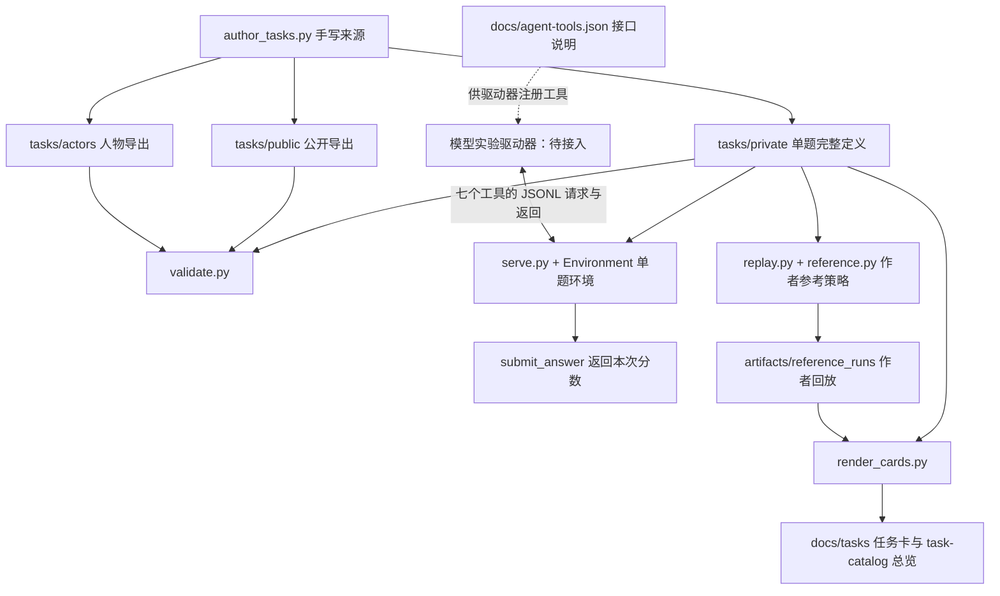

# DaySpanBench：测评流程中的文件使用指南

本文按当前v0.3代码的实际读写关系整理，覆盖12题的89个任务专属文件，以及共享脚本、引擎和文档。最后的逐题清单列出每一份人物配置及其触发环节。

新增的真实被测模型驱动器为`scripts/evaluate.py`；自动测评循环及日志文件的使用时机见[自动测评完整流程](automatic-evaluation.md)。下文任务专属文件的可见性与使用规则保持一致。

> 供作者、环境接入方与评审阅读；含内部转交关系与参考激活时间，不作为被测Agent的任务输入。

最重要的区分：**私有任务JSON是当前运行时的完整定义；公开JSON和人物JSON是导出视图；任务卡和参考回放用于作者验收与分析。它们不是一组需要一起塞进模型上下文的文件。**

## 1. 在哪里：四个参与方

| 参与方 | 放置和使用什么 | 当前实现 |
|---|---|---|
| 任务作者 / CI | 手写来源、验证脚本、测试、参考策略、任务卡生成器 | 在本仓库离线执行 |
| 可信环境主进程 | 私有任务JSON、共享引擎、日历、接收者、评分逻辑 | `scripts/serve.py`启动一个进程、加载一题；独立环境实例持有该题全部角色 |
| 被测Agent及其模型调用器 | 七个工具的接口定义、公开观察、已收到消息、自己的记忆 | `scripts/evaluate.py`调用真实模型并调度公开工具；也可用JSONL服务接外部Agent |
| 评测分析端 / 人类评审 | 最终分数、实际运行日志、私有审计；必要时对照作者参考回放 | 作者回放、episode日志和被测模型批量驱动器均已实现，自动生成结果总表与报告 |

同一机器可以承载这些参与方，但被测Agent不应获得可信主进程的Python对象或项目文件系统。人物模拟器也不是被测Agent：人物接收消息，Agent负责主动咨询、补件、等待和作答。



图中`public`和`actors`没有连到`serve.py`，因为当前服务不会单独读取这两种导出文件。运行时从私有定义的`public`和`actors`字段取得同样内容。

## 2. 何时：一次测评的完整顺序

| 阶段 | 何时做 | 输入文件 / 代码 | 产生或返回什么 |
|---|---|---|---|
| ① 编题与导出 | 任务内容、人物、日历或规则改变后 | `scripts/author_tasks.py` | 覆盖更新12份私有JSON、12份公开JSON、41份人物JSON |
| ② 静态验收与回归 | 导出后、正式测评前 | `scripts/validate.py`、`dayspanbench/validation.py`、`tests/test_environment.py` | 检查引用、转交材料、证据门槛、导出一致性和引擎行为；输出检查结果 |
| ③ 作者可行性验收 | 新题或规则改变后 | `scripts/replay.py`、`dayspanbench/reference.py`、私有任务JSON | 更新12份参考回放及`summary.json`；不是模型成绩 |
| ④ 生成人类审查材料 | 参考回放更新后 | `scripts/render_cards.py`读取私有JSON与参考回放 | 更新12份任务卡和`docs/task-catalog.md` |
| ⑤ 启动一个正式episode | 每个模型 × 每题 × 每次重复都重新启动 | `scripts/serve.py --task DSB-xx`加载该题私有JSON | 全新时钟、角色实例、事项、收件箱、事件队列和证据集合；可保存运行配置，尚无最终结果 |
| ⑥ 模型循环调用工具 | episode运行中 | 接入方用`docs/agent-tools.json`描述工具；服务调用引擎、接收者和日历 | 公开观察、消息、凭证、联系人、模拟时间；状态保存在进程内存，可用--run-dir保存日志 |
| ⑦ 最终提交与评分 | Agent决定完成，或到截止后作答 | `submit_answer`经Environment.evaluate调用scoring.py读取目标和本次证据 | 返回目标得分、成功类型、历时和消息数；指定--run-dir保存本次结果，不修改参考回放 |
| ⑧ 保存与分析模型实验 | episode结束或异常终止后 | 外层实验驱动器保存本次真实请求、响应与分数；可信主进程保存内部审计 | 服务可保存RPC/内部审计/模拟器调用/评分；被测模型自身输出和成本需外层驱动器记录 |

任务内容不变时，无需在每个模型episode前重跑①至④。正式episode只需要冻结好的私有定义和运行时代码。新的episode必须使用全新环境；在原实例里继续会继承消息、时间和证据。

## 3. 每题重复出现的五类文件

下列`DSB-xx`可替换为任意题号。

| 文件 | 谁 / 在哪里使用 | 何时使用 | 当前实际消费者 | 被测Agent可见性 |
|---|---|---|---|---|
| `tasks/private/DSB-xx.json` | 可信环境主进程、验证器、作者回放器、任务卡生成器 | 初始化时整题加载；交互和评分时继续使用内存中的字段 | `serve.py`、`validate.py`、`replay.py`、`render_cards.py`、测试 | 不提供：含隐藏事实、标准目标、参考动作和完整人物流程 |
| `tasks/public/DSB-xx.json` | 发布任务的接入方、导出一致性检查 | 准备公开任务包时；静态验证时 | 当前仅由`validate.py`直接检查；`serve.py`不读此文件 | 可公开，但当前Agent入口直接调用`observe`即可，无需另外传文件 |
| `tasks/actors/DSB-xx/<actor>.json` | 作者、人物模拟器开发者、验证器 | 审核人物权限、工具和流程时；未来独立角色服务可据此加载 | 当前`validate.py`直接读；运行时使用私有任务里内嵌的同名人物配置 | 不提供：包含人物私有知识、工具和内部流程 |
| `docs/tasks/DSB-xx.md` | 人类评审、环境开发者、错误分析人员 | 测评前审题；测评后定位时间、材料或评分问题 | 人工阅读，无运行时消费者 | 不提供：含隐藏事实、答案条件及参考时间线 |
| `artifacts/reference_runs/DSB-xx.json` | 作者验收、回归分析、任务卡生成器 | 验收参考路径；生成任务卡；与模型实际轨迹对照 | 由`replay.py`生成，由`render_cards.py`读取 | 不提供：含参考答案、特权轨迹和内部事件 |

公开文件里的`pages`是可公开资料，浏览器分两级：`observe()`只返回每页的`id/title/snippet`搜索链接，正文必须通过`visit_page()`访问。`visit_page()`同时把该页联系人（含具体邮箱/电话）加入可联系集合；看到人物ID不等于已经可以发送消息。每个页面带`snippet`摘要字段，验证器会检查。

## 4. 私有任务里各字段在哪一步发挥作用

| 字段 | 使用时机 | 具体作用 |
|---|---|---|
| `id/title/domain/schema_version/task_set_version` | 导出、验证、审查和版本记录 | 任务标识与元数据；服务器不根据版本字段动态选择实现 |
| `start_at/deadline_at` | 初始化、等待、新消息校验、评分 | 设置时钟和截止；截止后不接受新消息，但可以读取与最终提交 |
| `public.brief/user_fields/authorization` | `observe`；新事项受理 | 告知任务和已知资料；受理时检查场景字段一致性。授权文本是任务约束，不是通用自然语言行为审核器 |
| `public.initial_contacts/pages` | 初始化；观察、搜索、访问页面 | 初始化联系人；提供公开资料；访问页面注册新增联系人并给出其具体联络方式 |
| `public.message_budget` | 每次`send_message`与`call` | 当前每题16次发送预算，包含补件、催问和电话拨打；不是全工具调用预算 |
| `public.answer_keys/conclusion_options/answer_format` | 初始观察和最终作答 | 告知可用答案字段与结论标签，不公开正确选项 |
| `actors` | 初始化及每次交互 | 创建人物实例，提供角色、渠道、流程和白名单工具 |
| `calendars` | 每个工具步骤排程时 | 计算工作窗口、周末、时区、连续等待与批次 |
| `facts` | 人物查询或签发证据时 | 可信工具模拟器按角色权限取数；不是人物LLM的整段输入 |
| `goals/expected_conclusion/completion_class` | 最终评分 | 检查证据属性、归一化值、有效期、必要业务能力和成功类型 |
| `reference_actions` | 只在作者回放时 | 驱动特权参考策略；正常工具服务器不执行此字段 |
| `horizon_design` | 静态验证、参考历时校验、审查与分档分析 | 检查2–300天跨度；不自动推进时钟或强制Agent复现参考历时 |
| `temporal_mechanisms/failure_modes/alternate_paths/reference_is_privileged/synthetic/display_timezone` | 作者审查、说明与展示 | 元数据与解释；实际运行规则以人物步骤、日历和引擎为准 |

## 5. 人物文件与三个模拟组件的关系

每份人物JSON是**配置包，不是独立可执行程序，也不是运行到一半的存档**。所有角色共享Python实现，每次episode获得各自独立的状态实例。

| 人物包内容 | 对应组件 | 何时生效 | 当前实现细节 |
|---|---|---|---|
| `actor.id/name/role/channels` | 联系人与受理接口 | 公开联系人或收到消息时 | 检查联系人是否已发现、渠道是否支持 |
| `actor.process_engine` | 流程状态引擎 | 验证配置；运行时由引擎维护事项 | 状态迁移、单工作位和催问规则在`engine.py`实现；该清单不是任意状态机DSL，仅修改清单不能新增引擎能力 |
| `actor.workflows` | 事项受理与步骤执行 | 收到请求后；每一步完成后 | 校验必需字段和已观察凭证，选择下一工具及等待时间 |
| `actor.recipient.instructions`及工作流标签 | 接收者模拟器 | 新的外部消息需要判断意图时 | 构造当前人物的受限`view`；默认`RuleRecipient`做关键词路由 |
| `actor.recipient.rule_adapter/llm_adapter` | 适配器说明 | 接入或审查时 | 字符串只是清单元数据，不会自动动态导入或调用模型；CLI可启用LLMSimulator，或由主进程注入自定义回调 |
| `actor.recipient.reply_prefix` | 回复生成 | 对Agent正式回复时 | 引擎把前缀与实际取得的证据拼成回复；人物LLM当前不自由生成事实 |
| `actor.tools/knowledge` | 人物工具模拟器 | 排程步骤到期时 | 只允许本角色声明的查询、文书、转介、内部转交和回复 |
| `calendar` | 日历模拟器 | 计算开始、完成、批次时刻 | 独立导出的完整角色日历；当前运行时从私有定义的`calendars`取同样内容 |
| `local_facts` | 局部知识导出 | 配置验证、人工审查；未来角色服务加载 | 当前运行时由全局事实表加角色权限提供；不直接传给受限LLM路由回调 |
| `start_at/deadline_at` | 配置上下文 | 审查或未来独立加载时 | 不是当前动态时钟；运行中的`env.now`另存在内存 |

接收者的LLM回调可见角色指令、当前消息、字段、时间、工作流标签/别名/必需字段和自身事项状态；看不到完整人物JSON、全部事实、其他人物状态或评分目标。内部转交已经明确指定目标工作流，直接走引擎的结构化受理，不再调用目标人物的自然语言路由器。

## 6. 共享文件：真正被执行的代码和配套说明

| 文件 | 在哪里 / 何时使用 | 当前职责 |
|---|---|---|
| [scripts/author_tasks.py](/Users/weiwen/Documents/ChatGPT/DaySpanBench/scripts/author_tasks.py) | 作者准备阶段 | 12题的手写内容源；导出私有、公开和人物JSON。改题优先改这里，直接改导出JSON会在下次导出时被覆盖 |
| [scripts/validate.py](/Users/weiwen/Documents/ChatGPT/DaySpanBench/scripts/validate.py) | 作者/CI，导出后 | 遍历12题并比较公开、人物导出是否与私有定义一致；它没有生成或修复文件的作用 |
| [dayspanbench/validation.py](/Users/weiwen/Documents/ChatGPT/DaySpanBench/dayspanbench/validation.py) | 作者/CI，被验证脚本和测试调用 | 检查时间、人物、字段、证据门槛、工具引用和内部转交；当前serve.py不会自动调用它 |
| [scripts/replay.py](/Users/weiwen/Documents/ChatGPT/DaySpanBench/scripts/replay.py) | 作者/CI，可行性验收 | 重跑全部12题参考路径并覆盖reference_runs；校验设计历时，生成summary.json |
| [dayspanbench/reference.py](/Users/weiwen/Documents/ChatGPT/DaySpanBench/dayspanbench/reference.py) | 作者/CI，被replay.py和测试调用 | 执行私有reference_actions，用实际观察到的证据和私有目标组装参考答案；不得当成被测模型的规划器 |
| [scripts/render_cards.py](/Users/weiwen/Documents/ChatGPT/DaySpanBench/scripts/render_cards.py) | 作者，参考回放后 | 读取私有任务和参考回放，生成12份任务卡及总览；回放未更新就渲染会展示旧轨迹 |
| [scripts/serve.py](/Users/weiwen/Documents/ChatGPT/DaySpanBench/scripts/serve.py) | 可信主进程，每次episode | 加载一题并分发JSONL；--simulator llm调用人物模型，--run-dir保存单次日志 |
| [dayspanbench/engine.py](/Users/weiwen/Documents/ChatGPT/DaySpanBench/dayspanbench/engine.py) | 可信主进程，初始化至评分全程 | ActorState、事项状态机、事件队列、人物工具和Agent工具；evaluate调用scoring.py |
| [dayspanbench/calendar.py](/Users/weiwen/Documents/ChatGPT/DaySpanBench/dayspanbench/calendar.py) | 可信主进程，每次排程和时间推进 | 时区、工作时段、连续时间、固定批次和not_before计算；没有真实睡眠 |
| [dayspanbench/recipient.py](/Users/weiwen/Documents/ChatGPT/DaySpanBench/dayspanbench/recipient.py) | 可信主进程，新消息意图路由 | 默认规则路由和旧的路由回调；新HTTP模拟器见simulator.py与llm.py |
| [dayspanbench/__init__.py](/Users/weiwen/Documents/ChatGPT/DaySpanBench/dayspanbench/__init__.py) | Python导入包时 | 包入口；无独立测评阶段或额外产物 |
| [docs/agent-tools.json](/Users/weiwen/Documents/ChatGPT/DaySpanBench/docs/agent-tools.json) | 模型接入方，注册工具时 | 七个公开工具的参数定义；需接入方转换为所用模型的工具格式，serve.py本身不读取或执行这个Schema |
| [tests/test_environment.py](/Users/weiwen/Documents/ChatGPT/DaySpanBench/tests/test_environment.py) | 开发/CI，正式实验前或引擎变更后 | 日历、权限、消息、证据、长期流程、参考历时和RPC回归测试；测试成功不是模型成功 |
| [artifacts/reference_runs/summary.json](/Users/weiwen/Documents/ChatGPT/DaySpanBench/artifacts/reference_runs/summary.json) | 作者和评审，参考回放完成后 | 12条作者参考结果的聚合，含跨度、成功类型和成本；不是模型排行榜 |
| [docs/task-catalog.md](/Users/weiwen/Documents/ChatGPT/DaySpanBench/docs/task-catalog.md) | 评审/实验设计人员，选题和分层分析时 | 12题标题、人物数、参考历时和结果类型总览 |
| [docs/horizon-design.md](/Users/weiwen/Documents/ChatGPT/DaySpanBench/docs/horizon-design.md) | 评审/实验设计人员，制定分档与分析时 | 2–300天分布理由及DSB-12跨月阶段说明；不控制实际时钟 |
| [docs/environment-contract.md](/Users/weiwen/Documents/ChatGPT/DaySpanBench/docs/environment-contract.md) | 接入方/评审，编写驱动器与解释评分时 | 观察、时间、状态、证据、答案及评分协议；实际行为仍以代码为准 |
| [docs/recipient-and-tools.md](/Users/weiwen/Documents/ChatGPT/DaySpanBench/docs/recipient-and-tools.md) | 环境开发者，接入人物LLM或增加工具时 | 受限回调接口与工具扩展说明，不是直接喂给被测Agent的提示词 |
| [README.md](/Users/weiwen/Documents/ChatGPT/DaySpanBench/README.md) | 使用者，首次进入项目时 | 项目入口、运行命令和文件导航 |
| [pyproject.toml](/Users/weiwen/Documents/ChatGPT/DaySpanBench/pyproject.toml) | 安装/环境准备时 | 包版本、Python版本与依赖元数据；不是每题参数或实验配置 |
| [.gitignore](/Users/weiwen/Documents/ChatGPT/DaySpanBench/.gitignore) | 版本管理时 | 忽略缓存、虚拟环境等；不会在运行时隔离模型可访问文件 |
| [docs/evaluation-file-guide.md](/Users/weiwen/Documents/ChatGPT/DaySpanBench/docs/evaluation-file-guide.md) | 接入方/评审，需要追踪文件流向时 | 本文：逐阶段职责、逐题逐文件索引；不被运行时读取 |
| [dayspanbench/scoring.py](/Users/weiwen/Documents/ChatGPT/DaySpanBench/dayspanbench/scoring.py) | 最终评分与受理证据匹配 | 归一化、证据属性、能力状态和失败原因 |
| [dayspanbench/llm.py](/Users/weiwen/Documents/ChatGPT/DaySpanBench/dayspanbench/llm.py) | LLM人物交互时 | Chat/Responses HTTP调用、结构化返回、重试和日志 |
| [dayspanbench/simulator.py](/Users/weiwen/Documents/ChatGPT/DaySpanBench/dayspanbench/simulator.py) | LLM人物交互时 | 局部上下文、字段抽取和受约束回复规划 |
| [tests/test_scoring.py](/Users/weiwen/Documents/ChatGPT/DaySpanBench/tests/test_scoring.py) | CI/评分变更后 | 合法替代路径、归一化和无效证据负例 |
| [tests/test_simulator.py](/Users/weiwen/Documents/ChatGPT/DaySpanBench/tests/test_simulator.py) | CI/模拟器变更后 | 隔离、越权、HTTP协议与CLI日志测试 |
| [docs/scoring-and-simulator.md](/Users/weiwen/Documents/ChatGPT/DaySpanBench/docs/scoring-and-simulator.md) | 接入和评审时 | v0.3评分、LLM参数、日志和运行命令 |

## 7. 正式模型测评的日志文件

v0.3的`serve.py --run-dir <目录>`已能保存一次环境episode：`manifest.json`记录版本/哈希/模拟器配置，`rpc_trace.jsonl`记录工具交互，`private_audit.jsonl`记录内部流程，`simulator_calls.jsonl`记录人物LLM请求与响应，`final_answer.json`保存最终提交，`result.json`保存评分或终止原因。日志目录必须新建或为空，参考回放文件不会被覆盖。详见[运行指南](scoring-and-simulator.md)。

模拟器出错会记录`valid_episode=false`，不能当作有效Agent失败。被测模型自身的完整上下文、输出、token成本及批量调度仍由外层驱动器负责；服务不会自行运行被测模型。

可约定`artifacts/evaluation_runs/<run_id>/DSB-xx/<repeat_id>/`为每次--run-dir。日志由可信主进程保管，尤其私有审计和人物提示词不能提供给Agent。日志与人物JSON都不是checkpoint，进程重启不能恢复状态。

独立`serve.py`不限制读取或等待工具的总调用数；自动驱动器`evaluate.py`默认限制80个Agent决策步骤，每次生成最多4096个输出token，并设置API超时与重试上限。每题消息预算继续由环境执行。完整配置与日志说明见[自动测评流程](automatic-evaluation.md)。

## 8. DSB-12串起一次运行

1. 作者修改`author_tasks.py`，导出DSB-12的私有定义、公开视图和5份人物包；验证并参考回放后生成任务卡。
2. 可信主进程运行`python3 scripts/serve.py --task DSB-12`。它只读取DSB-12私有定义并创建5个人物实例；没有启动5个Python服务。
3. 模型驱动器向同一持续运行的进程发送`observe`，把返回的公开任务和联系人交给被测Agent。人物包、任务卡和参考答案不进入模型上下文。
4. Agent联系`forwarder`；引擎创建事项并内部转给`warehouse`，到期后回传记录和新联系人。此阶段不会重新打开`warehouse.json`；使用的是启动时已加载的私有配置。
5. Agent联系`exporter`取v2，再联系`customsdesk`初审；内部`broker/preliminary`到期返回登记号。随后Agent再次联系`exporter`取得v3和溯源材料。
6. Agent带新版证据联系`customsdesk/final`，内部进入`broker/main`长期复核。`calendar.py`和事件队列负责跨月等待；原单证到期后不能用于新受理。
7. 到300天截止，Agent提交已有四项证据和放行未确认。scoring.py检查目标、本次证据与已受理的技术复核能力，也接受材料齐备后经转介直联代理。
8. JSONL返回本次分数。指定--run-dir时服务保存本次环境日志与结果；现有`artifacts/reference_runs/DSB-12.json`保持作者回放含义。

## 9. 逐题、逐文件清单

以下每题的四份通用文件按实际阶段标注；每份人物文件再标注配置所对应的业务环节。**人物JSON在当前运行中均不直接读取**：启动时载入的是私有JSON内的对应配置；表中“触发”描述该配置何时产生事项，不能理解成那时才去打开导出文件。

“首次事项时间”取自作者参考回放，统一为北京时间，只帮助定位阶段；它不是人物固定激活时刻或唯一合法路径。全部人物实例在episode初始化时已经创建。

### DSB-01 · 活动场地：跨周末确认设备与报价（参考3天）

| 文件 | 何时 / 在哪里使用 |
|---|---|
| [tasks/private/DSB-01.json](/Users/weiwen/Documents/ChatGPT/DaySpanBench/tasks/private/DSB-01.json) | 可信主进程启动、运行与评分；作者验证/回放/制卡也读取 |
| [tasks/public/DSB-01.json](/Users/weiwen/Documents/ChatGPT/DaySpanBench/tasks/public/DSB-01.json) | 准备公开发布或接入包、导出一致性验证；当前服务不单独读取 |
| [docs/tasks/DSB-01.md](/Users/weiwen/Documents/ChatGPT/DaySpanBench/docs/tasks/DSB-01.md) | 测评前人工审题、测评后对照分析；含隐藏信息 |
| [artifacts/reference_runs/DSB-01.json](/Users/weiwen/Documents/ChatGPT/DaySpanBench/artifacts/reference_runs/DSB-01.json) | 作者参考验收、任务卡生成、轨迹对照；不是模型结果 |

| 人物配置文件 | 角色 / 负责环节 | 在运行中如何触发 | 参考首次事项时间 |
|---|---|---|---|
| [reception.json](/Users/weiwen/Documents/ChatGPT/DaySpanBench/tasks/actors/DSB-01/reception.json) | 禾岸会馆前台·陈芷；`main`（活动联系入口） | 初始联系人，Agent直接联系 | 2026-11-06 10:00 |
| [sales.json](/Users/weiwen/Documents/ChatGPT/DaySpanBench/tasks/actors/DSB-01/sales.json) | 禾岸会馆销售·姚岚；`main`（报价及取消条件） | `reception/main`转介后联系 | 2026-11-06 10:30 |
| [operations.json](/Users/weiwen/Documents/ChatGPT/DaySpanBench/tasks/actors/DSB-01/operations.json) | 禾岸会馆运营·赵航；`main`（档期与投影确认） | `reception/main`转介后联系 | 2026-11-06 10:30 |
| [technician.json](/Users/weiwen/Documents/ChatGPT/DaySpanBench/tasks/actors/DSB-01/technician.json) | 禾岸会馆设备主管·周敏；`main`（核对维修窗口） | `operations/main`内部转至`technician/main` | 2026-11-06 13:30 |

### DSB-02 · 租房咨询：物业周审与新一期货梯表（参考8天）

| 文件 | 何时 / 在哪里使用 |
|---|---|
| [tasks/private/DSB-02.json](/Users/weiwen/Documents/ChatGPT/DaySpanBench/tasks/private/DSB-02.json) | 可信主进程启动、运行与评分；作者验证/回放/制卡也读取 |
| [tasks/public/DSB-02.json](/Users/weiwen/Documents/ChatGPT/DaySpanBench/tasks/public/DSB-02.json) | 准备公开发布或接入包、导出一致性验证；当前服务不单独读取 |
| [docs/tasks/DSB-02.md](/Users/weiwen/Documents/ChatGPT/DaySpanBench/docs/tasks/DSB-02.md) | 测评前人工审题、测评后对照分析；含隐藏信息 |
| [artifacts/reference_runs/DSB-02.json](/Users/weiwen/Documents/ChatGPT/DaySpanBench/artifacts/reference_runs/DSB-02.json) | 作者参考验收、任务卡生成、轨迹对照；不是模型结果 |

| 人物配置文件 | 角色 / 负责环节 | 在运行中如何触发 | 参考首次事项时间 |
|---|---|---|---|
| [landlord.json](/Users/weiwen/Documents/ChatGPT/DaySpanBench/tasks/actors/DSB-02/landlord.json) | 房东·林霁；`main`（租金、宠物和搬入条件） | 初始联系人，Agent直接联系 | 2026-11-03 19:30 |
| [manager.json](/Users/weiwen/Documents/ChatGPT/DaySpanBench/tasks/actors/DSB-02/manager.json) | 青栎公寓物业·许乔；`main`（宠物与搬入复核） | `landlord/main`内部转至`manager/main` | 2026-11-03 20:30 |
| [reviewer.json](/Users/weiwen/Documents/ChatGPT/DaySpanBench/tasks/actors/DSB-02/reviewer.json) | 青栎公寓规则审核员·丁悦；`main`（周五规则审核） | `manager/main`内部转至`reviewer/main` | 2026-11-04 10:00 |

### DSB-03 · 学分转换：秋季补件与春季集中审议（参考89天）

| 文件 | 何时 / 在哪里使用 |
|---|---|
| [tasks/private/DSB-03.json](/Users/weiwen/Documents/ChatGPT/DaySpanBench/tasks/private/DSB-03.json) | 可信主进程启动、运行与评分；作者验证/回放/制卡也读取 |
| [tasks/public/DSB-03.json](/Users/weiwen/Documents/ChatGPT/DaySpanBench/tasks/public/DSB-03.json) | 准备公开发布或接入包、导出一致性验证；当前服务不单独读取 |
| [docs/tasks/DSB-03.md](/Users/weiwen/Documents/ChatGPT/DaySpanBench/docs/tasks/DSB-03.md) | 测评前人工审题、测评后对照分析；含隐藏信息 |
| [artifacts/reference_runs/DSB-03.json](/Users/weiwen/Documents/ChatGPT/DaySpanBench/artifacts/reference_runs/DSB-03.json) | 作者参考验收、任务卡生成、轨迹对照；不是模型结果 |

| 人物配置文件 | 角色 / 负责环节 | 在运行中如何触发 | 参考首次事项时间 |
|---|---|---|---|
| [records.json](/Users/weiwen/Documents/ChatGPT/DaySpanBench/tasks/actors/DSB-03/records.json) | 澄川学院教务·唐宁；`main`（学分转换咨询） | 初始联系人，Agent直接联系 | 2026-11-05 14:00 |
| [lecturer.json](/Users/weiwen/Documents/ChatGPT/DaySpanBench/tasks/actors/DSB-03/lecturer.json) | CS204课程负责人·梅芮；`main`（补发正式大纲） | 读公开页`faculty`发现 | 2026-11-05 14:00 |
| [board.json](/Users/weiwen/Documents/ChatGPT/DaySpanBench/tasks/actors/DSB-03/board.json) | 澄川学院学分委员会秘书·程昕；`main`（春季跨校审议） | `records/main`内部转至`board/main` | 2026-11-10 17:00 |

### DSB-04 · 共享仪器：培训、进口耗材与七天稳定性校准（参考21天）

| 文件 | 何时 / 在哪里使用 |
|---|---|
| [tasks/private/DSB-04.json](/Users/weiwen/Documents/ChatGPT/DaySpanBench/tasks/private/DSB-04.json) | 可信主进程启动、运行与评分；作者验证/回放/制卡也读取 |
| [tasks/public/DSB-04.json](/Users/weiwen/Documents/ChatGPT/DaySpanBench/tasks/public/DSB-04.json) | 准备公开发布或接入包、导出一致性验证；当前服务不单独读取 |
| [docs/tasks/DSB-04.md](/Users/weiwen/Documents/ChatGPT/DaySpanBench/docs/tasks/DSB-04.md) | 测评前人工审题、测评后对照分析；含隐藏信息 |
| [artifacts/reference_runs/DSB-04.json](/Users/weiwen/Documents/ChatGPT/DaySpanBench/artifacts/reference_runs/DSB-04.json) | 作者参考验收、任务卡生成、轨迹对照；不是模型结果 |

| 人物配置文件 | 角色 / 负责环节 | 在运行中如何触发 | 参考首次事项时间 |
|---|---|---|---|
| [labdesk.json](/Users/weiwen/Documents/ChatGPT/DaySpanBench/tasks/actors/DSB-04/labdesk.json) | 南屿共享实验室前台·叶青；`main`（测量咨询入口） | 初始联系人，Agent直接联系 | 2026-11-04 09:30 |
| [safety.json](/Users/weiwen/Documents/ChatGPT/DaySpanBench/tasks/actors/DSB-04/safety.json) | 南屿实验室安全员·温遥；`main`（培训记录确认） | `labdesk/main`转介后联系 | 2026-11-04 10:00 |
| [instrument.json](/Users/weiwen/Documents/ChatGPT/DaySpanBench/tasks/actors/DSB-04/instrument.json) | 仪器管理员·杜和；`main`（测量可用时间与费用） | `labdesk/main`转介后联系 | 2026-11-06 17:00 |
| [stores.json](/Users/weiwen/Documents/ChatGPT/DaySpanBench/tasks/actors/DSB-04/stores.json) | 耗材库管理员·宋野；`main`（核实滤芯到库） | `instrument/main`内部转至`stores/main` | 2026-11-09 10:00 |

### DSB-05 · 制造采购：28天耐久测试后重新询价（参考34天）

| 文件 | 何时 / 在哪里使用 |
|---|---|
| [tasks/private/DSB-05.json](/Users/weiwen/Documents/ChatGPT/DaySpanBench/tasks/private/DSB-05.json) | 可信主进程启动、运行与评分；作者验证/回放/制卡也读取 |
| [tasks/public/DSB-05.json](/Users/weiwen/Documents/ChatGPT/DaySpanBench/tasks/public/DSB-05.json) | 准备公开发布或接入包、导出一致性验证；当前服务不单独读取 |
| [docs/tasks/DSB-05.md](/Users/weiwen/Documents/ChatGPT/DaySpanBench/docs/tasks/DSB-05.md) | 测评前人工审题、测评后对照分析；含隐藏信息 |
| [artifacts/reference_runs/DSB-05.json](/Users/weiwen/Documents/ChatGPT/DaySpanBench/artifacts/reference_runs/DSB-05.json) | 作者参考验收、任务卡生成、轨迹对照；不是模型结果 |

| 人物配置文件 | 角色 / 负责环节 | 在运行中如何触发 | 参考首次事项时间 |
|---|---|---|---|
| [sales.json](/Users/weiwen/Documents/ChatGPT/DaySpanBench/tasks/actors/DSB-05/sales.json) | 棱川制造销售·罗岑；`main`（初次报价）、`refresh`（刷新过期报价） | 初始联系人，Agent直接联系 | 2026-11-03 14:00 |
| [factory.json](/Users/weiwen/Documents/ChatGPT/DaySpanBench/tasks/actors/DSB-05/factory.json) | 棱川制造排产员·苏渝；`main`（排产可行性） | `sales/main`内部转至`factory/main` | 2026-11-03 16:00 |
| [qa.json](/Users/weiwen/Documents/ChatGPT/DaySpanBench/tasks/actors/DSB-05/qa.json) | 棱川制造质检·傅黎；`main`（材料Q7报告） | 读公开页`supplier`发现 | 2026-11-03 14:00 |

### DSB-06 · 家电保修：等待原厂补货与工程师轮值（参考13天）

| 文件 | 何时 / 在哪里使用 |
|---|---|
| [tasks/private/DSB-06.json](/Users/weiwen/Documents/ChatGPT/DaySpanBench/tasks/private/DSB-06.json) | 可信主进程启动、运行与评分；作者验证/回放/制卡也读取 |
| [tasks/public/DSB-06.json](/Users/weiwen/Documents/ChatGPT/DaySpanBench/tasks/public/DSB-06.json) | 准备公开发布或接入包、导出一致性验证；当前服务不单独读取 |
| [docs/tasks/DSB-06.md](/Users/weiwen/Documents/ChatGPT/DaySpanBench/docs/tasks/DSB-06.md) | 测评前人工审题、测评后对照分析；含隐藏信息 |
| [artifacts/reference_runs/DSB-06.json](/Users/weiwen/Documents/ChatGPT/DaySpanBench/artifacts/reference_runs/DSB-06.json) | 作者参考验收、任务卡生成、轨迹对照；不是模型结果 |

| 人物配置文件 | 角色 / 负责环节 | 在运行中如何触发 | 参考首次事项时间 |
|---|---|---|---|
| [support.json](/Users/weiwen/Documents/ChatGPT/DaySpanBench/tasks/actors/DSB-06/support.json) | 霁光电器客服·孟竹；`main`（保修及维修时间咨询） | 初始联系人，Agent直接联系 | 2026-11-04 16:00 |
| [engineer.json](/Users/weiwen/Documents/ChatGPT/DaySpanBench/tasks/actors/DSB-06/engineer.json) | 霁光工程师·韩则；`main`（诊断故障） | `support/main`内部转至`engineer/main` | 2026-11-05 10:00 |
| [parts.json](/Users/weiwen/Documents/ChatGPT/DaySpanBench/tasks/actors/DSB-06/parts.json) | 霁光零件库·纪桐；`main`（零件库存复核） | `engineer/main`内部转至`parts/main` | 2026-11-05 17:00 |

### DSB-07 · 档案使用：权利继受核验后重新启动数字化（参考210天）

| 文件 | 何时 / 在哪里使用 |
|---|---|
| [tasks/private/DSB-07.json](/Users/weiwen/Documents/ChatGPT/DaySpanBench/tasks/private/DSB-07.json) | 可信主进程启动、运行与评分；作者验证/回放/制卡也读取 |
| [tasks/public/DSB-07.json](/Users/weiwen/Documents/ChatGPT/DaySpanBench/tasks/public/DSB-07.json) | 准备公开发布或接入包、导出一致性验证；当前服务不单独读取 |
| [docs/tasks/DSB-07.md](/Users/weiwen/Documents/ChatGPT/DaySpanBench/docs/tasks/DSB-07.md) | 测评前人工审题、测评后对照分析；含隐藏信息 |
| [artifacts/reference_runs/DSB-07.json](/Users/weiwen/Documents/ChatGPT/DaySpanBench/artifacts/reference_runs/DSB-07.json) | 作者参考验收、任务卡生成、轨迹对照；不是模型结果 |

| 人物配置文件 | 角色 / 负责环节 | 在运行中如何触发 | 参考首次事项时间 |
|---|---|---|---|
| [archive.json](/Users/weiwen/Documents/ChatGPT/DaySpanBench/tasks/actors/DSB-07/archive.json) | 北汀档案馆接待·关雨；`main`（费用与权利联系人）、`digitize`（取得许可后的数字化规格确认） | 初始联系人，Agent直接联系 | 2026-11-05 15:00 |
| [rights.json](/Users/weiwen/Documents/ChatGPT/DaySpanBench/tasks/actors/DSB-07/rights.json) | 权利方联络员·Alex Chen；`main`（权利范围核实） | `archive/main`转介后联系 | 2026-11-06 09:30 |
| [digitizer.json](/Users/weiwen/Documents/ChatGPT/DaySpanBench/tasks/actors/DSB-07/digitizer.json) | 档案数字化员·林澈；`main`（扫描质量核对） | `archive/digitize`内部转至`digitizer/main` | 2027-05-31 11:00 |

### DSB-08 · 无障碍住宿：两家机构比较与延后的现场测量（参考5天）

| 文件 | 何时 / 在哪里使用 |
|---|---|
| [tasks/private/DSB-08.json](/Users/weiwen/Documents/ChatGPT/DaySpanBench/tasks/private/DSB-08.json) | 可信主进程启动、运行与评分；作者验证/回放/制卡也读取 |
| [tasks/public/DSB-08.json](/Users/weiwen/Documents/ChatGPT/DaySpanBench/tasks/public/DSB-08.json) | 准备公开发布或接入包、导出一致性验证；当前服务不单独读取 |
| [docs/tasks/DSB-08.md](/Users/weiwen/Documents/ChatGPT/DaySpanBench/docs/tasks/DSB-08.md) | 测评前人工审题、测评后对照分析；含隐藏信息 |
| [artifacts/reference_runs/DSB-08.json](/Users/weiwen/Documents/ChatGPT/DaySpanBench/artifacts/reference_runs/DSB-08.json) | 作者参考验收、任务卡生成、轨迹对照；不是模型结果 |

| 人物配置文件 | 角色 / 负责环节 | 在运行中如何触发 | 参考首次事项时间 |
|---|---|---|---|
| [a_desk.json](/Users/weiwen/Documents/ChatGPT/DaySpanBench/tasks/actors/DSB-08/a_desk.json) | A旅舍前台·蓝心；`main`（通行尺寸确认） | 初始联系人，Agent直接联系 | 2026-11-06 13:30 |
| [a_tech.json](/Users/weiwen/Documents/ChatGPT/DaySpanBench/tasks/actors/DSB-08/a_tech.json) | A旅舍设施员·蒋延；`main`（现场通行测量） | `a_desk/main`内部转至`a_tech/main` | 2026-11-06 14:30 |
| [b_desk.json](/Users/weiwen/Documents/ChatGPT/DaySpanBench/tasks/actors/DSB-08/b_desk.json) | B酒店预订咨询·米禾；`main`（无障碍房确认） | 读公开页`hotels`发现 | 2026-11-06 13:30 |
| [b_tech.json](/Users/weiwen/Documents/ChatGPT/DaySpanBench/tasks/actors/DSB-08/b_tech.json) | B酒店设施主管·郑砚；`main`（指定房间量测） | `b_desk/main`内部转至`b_tech/main` | 2026-11-06 15:00 |

### DSB-09 · 公共活动咨询：意见征集与年末联合复核（参考55天）

| 文件 | 何时 / 在哪里使用 |
|---|---|
| [tasks/private/DSB-09.json](/Users/weiwen/Documents/ChatGPT/DaySpanBench/tasks/private/DSB-09.json) | 可信主进程启动、运行与评分；作者验证/回放/制卡也读取 |
| [tasks/public/DSB-09.json](/Users/weiwen/Documents/ChatGPT/DaySpanBench/tasks/public/DSB-09.json) | 准备公开发布或接入包、导出一致性验证；当前服务不单独读取 |
| [docs/tasks/DSB-09.md](/Users/weiwen/Documents/ChatGPT/DaySpanBench/docs/tasks/DSB-09.md) | 测评前人工审题、测评后对照分析；含隐藏信息 |
| [artifacts/reference_runs/DSB-09.json](/Users/weiwen/Documents/ChatGPT/DaySpanBench/artifacts/reference_runs/DSB-09.json) | 作者参考验收、任务卡生成、轨迹对照；不是模型结果 |

| 人物配置文件 | 角色 / 负责环节 | 在运行中如何触发 | 参考首次事项时间 |
|---|---|---|---|
| [service.json](/Users/weiwen/Documents/ChatGPT/DaySpanBench/tasks/actors/DSB-09/service.json) | 晴港政务咨询台·谢茵；`main`（活动事项咨询） | 初始联系人，Agent直接联系 | 2026-11-03 15:00 |
| [land.json](/Users/weiwen/Documents/ChatGPT/DaySpanBench/tasks/actors/DSB-09/land.json) | 公共空间管理联络员·吴弈；`main`（管辖材料复核） | `service/main`内部转至`land/main` | 2026-11-03 17:00 |
| [sound.json](/Users/weiwen/Documents/ChatGPT/DaySpanBench/tasks/actors/DSB-09/sound.json) | 活动环境咨询员·陆笙；`main`（意见征集阶段确认）、`final`（联合分类复核） | `service/main`转介后联系 | 2026-11-05 15:00 |

### DSB-10 · 二手相机：夜间联系、周末实测与取件咨询（参考2天）

| 文件 | 何时 / 在哪里使用 |
|---|---|
| [tasks/private/DSB-10.json](/Users/weiwen/Documents/ChatGPT/DaySpanBench/tasks/private/DSB-10.json) | 可信主进程启动、运行与评分；作者验证/回放/制卡也读取 |
| [tasks/public/DSB-10.json](/Users/weiwen/Documents/ChatGPT/DaySpanBench/tasks/public/DSB-10.json) | 准备公开发布或接入包、导出一致性验证；当前服务不单独读取 |
| [docs/tasks/DSB-10.md](/Users/weiwen/Documents/ChatGPT/DaySpanBench/docs/tasks/DSB-10.md) | 测评前人工审题、测评后对照分析；含隐藏信息 |
| [artifacts/reference_runs/DSB-10.json](/Users/weiwen/Documents/ChatGPT/DaySpanBench/artifacts/reference_runs/DSB-10.json) | 作者参考验收、任务卡生成、轨迹对照；不是模型结果 |

| 人物配置文件 | 角色 / 负责环节 | 在运行中如何触发 | 参考首次事项时间 |
|---|---|---|---|
| [seller.json](/Users/weiwen/Documents/ChatGPT/DaySpanBench/tasks/actors/DSB-10/seller.json) | 相机卖家·沈栖；`main`（相机实测与条款） | 初始联系人，Agent直接联系 | 2026-11-06 10:00 |
| [friend.json](/Users/weiwen/Documents/ChatGPT/DaySpanBench/tasks/actors/DSB-10/friend.json) | 卖家朋友·柯闻；`main`（读取相机与测试） | `seller/main`内部转至`friend/main` | 2026-11-06 21:00 |
| [courier.json](/Users/weiwen/Documents/ChatGPT/DaySpanBench/tasks/actors/DSB-10/courier.json) | 桥溪快运取件咨询·曾澜；`main`（最早取件时间） | `seller/main`转介后联系 | 2026-11-07 20:30 |

### DSB-11 · 开源兼容性：补丁验证后跟进跨季度发布（参考144天）

| 文件 | 何时 / 在哪里使用 |
|---|---|
| [tasks/private/DSB-11.json](/Users/weiwen/Documents/ChatGPT/DaySpanBench/tasks/private/DSB-11.json) | 可信主进程启动、运行与评分；作者验证/回放/制卡也读取 |
| [tasks/public/DSB-11.json](/Users/weiwen/Documents/ChatGPT/DaySpanBench/tasks/public/DSB-11.json) | 准备公开发布或接入包、导出一致性验证；当前服务不单独读取 |
| [docs/tasks/DSB-11.md](/Users/weiwen/Documents/ChatGPT/DaySpanBench/docs/tasks/DSB-11.md) | 测评前人工审题、测评后对照分析；含隐藏信息 |
| [artifacts/reference_runs/DSB-11.json](/Users/weiwen/Documents/ChatGPT/DaySpanBench/artifacts/reference_runs/DSB-11.json) | 作者参考验收、任务卡生成、轨迹对照；不是模型结果 |

| 人物配置文件 | 角色 / 负责环节 | 在运行中如何触发 | 参考首次事项时间 |
|---|---|---|---|
| [maintainer.json](/Users/weiwen/Documents/ChatGPT/DaySpanBench/tasks/actors/DSB-11/maintainer.json) | 星舟项目维护者·简川；`main`（兼容问题确认）、`release_check`（季度发布状态复核） | 初始联系人，Agent直接联系 | 2026-11-07 20:30 |
| [ci.json](/Users/weiwen/Documents/ChatGPT/DaySpanBench/tasks/actors/DSB-11/ci.json) | 星舟CI值守·自动检查器；`main`（48小时构建验证） | `maintainer/main`内部转至`ci/main` | 2026-11-09 22:00 |
| [release.json](/Users/weiwen/Documents/ChatGPT/DaySpanBench/tasks/actors/DSB-11/release.json) | 星舟发布协调员·唐泊；`main`（季度候选发布核对） | `maintainer/release_check`内部转至`release/main` | 2027-03-29 20:00 |

### DSB-12 · 跨境原型设备：300天内的初审、二次补件与未决放行（参考300天）

| 文件 | 何时 / 在哪里使用 |
|---|---|
| [tasks/private/DSB-12.json](/Users/weiwen/Documents/ChatGPT/DaySpanBench/tasks/private/DSB-12.json) | 可信主进程启动、运行与评分；作者验证/回放/制卡也读取 |
| [tasks/public/DSB-12.json](/Users/weiwen/Documents/ChatGPT/DaySpanBench/tasks/public/DSB-12.json) | 准备公开发布或接入包、导出一致性验证；当前服务不单独读取 |
| [docs/tasks/DSB-12.md](/Users/weiwen/Documents/ChatGPT/DaySpanBench/docs/tasks/DSB-12.md) | 测评前人工审题、测评后对照分析；含隐藏信息 |
| [artifacts/reference_runs/DSB-12.json](/Users/weiwen/Documents/ChatGPT/DaySpanBench/artifacts/reference_runs/DSB-12.json) | 作者参考验收、任务卡生成、轨迹对照；不是模型结果 |

| 人物配置文件 | 角色 / 负责环节 | 在运行中如何触发 | 参考首次事项时间 |
|---|---|---|---|
| [forwarder.json](/Users/weiwen/Documents/ChatGPT/DaySpanBench/tasks/actors/DSB-12/forwarder.json) | 远澄货运客服·白榆；`main`（货件状态与联系入口） | 初始联系人，Agent直接联系 | 2026-11-06 15:00 |
| [warehouse.json](/Users/weiwen/Documents/ChatGPT/DaySpanBench/tasks/actors/DSB-12/warehouse.json) | 始发仓查件员·施瑾；`main`（入库扫描查证） | `forwarder/main`内部转至`warehouse/main` | 2026-11-06 16:00 |
| [exporter.json](/Users/weiwen/Documents/ChatGPT/DaySpanBench/tasks/actors/DSB-12/exporter.json) | 出口方单证员·贺悠；`main`（首轮更正单证）、`refresh`（第二轮单证和批次溯源） | `forwarder/main`转介后联系 | 2026-11-09 11:30 |
| [customsdesk.json](/Users/weiwen/Documents/ChatGPT/DaySpanBench/tasks/actors/DSB-12/customsdesk.json) | 远澄单证联络·戴筠；`main`（归类初审登记）、`final`（第二轮长期复核）、`direct_entry`（材料齐备后转介境外代理直联） | `forwarder/main`转介后联系 | 2026-12-07 14:00 |
| [broker.json](/Users/weiwen/Documents/ChatGPT/DaySpanBench/tasks/actors/DSB-12/broker.json) | 境外代理·Morgan Lee；`preliminary`（归类初审）、`main`（长期技术复核） | `customsdesk/main`内部转至`broker/preliminary`；`customsdesk/final`内部转至`broker/main`；`customsdesk/direct_entry`转介后联系 | 2026-12-07 15:00 |

## 10. 更新和运行顺序

在仓库根目录，只有改题后才需要重新导出。下面的回放命令会覆盖作者参考产物，不会运行真实LLM：

```bash
python3 scripts/author_tasks.py
python3 scripts/validate.py
python3 -m unittest discover -s tests -v
python3 scripts/replay.py
python3 scripts/render_cards.py
```

启动一个全新episode：

```bash
python3 scripts/serve.py --task DSB-12
```

模型驱动器保持该进程存活，通过stdin/stdout逐行交互。例如首次请求：

```json
{"id":1,"tool":"observe","arguments":{}}
```

不要每调用一个工具就重启服务，否则之前的事项、时间和证据全部丢失。完成一题后再为下一题或下一次重复启动新进程。当前所有运行状态保存在内存，尚无中途重启恢复协议。

## 11. 本说明的代码依据

- [服务器只加载私有任务JSON，并按白名单分发工具](/Users/weiwen/Documents/ChatGPT/DaySpanBench/scripts/serve.py)。
- [初始化角色实例与进程内状态](/Users/weiwen/Documents/ChatGPT/DaySpanBench/dayspanbench/engine.py)。
- [observe只返回页面搜索链接，visit_page登记联系人](/Users/weiwen/Documents/ChatGPT/DaySpanBench/dayspanbench/engine.py)。
- [接收者仅取得受限view](/Users/weiwen/Documents/ChatGPT/DaySpanBench/dayspanbench/engine.py)。
- [最终评分读取目标及本次证据](/Users/weiwen/Documents/ChatGPT/DaySpanBench/dayspanbench/scoring.py)。
- [submit_answer只返回一次评分](/Users/weiwen/Documents/ChatGPT/DaySpanBench/dayspanbench/engine.py)。
- [同源导出私有、公开和人物配置](/Users/weiwen/Documents/ChatGPT/DaySpanBench/scripts/author_tasks.py)。
- [作者回放读取、执行和保存路径](/Users/weiwen/Documents/ChatGPT/DaySpanBench/scripts/replay.py)。
