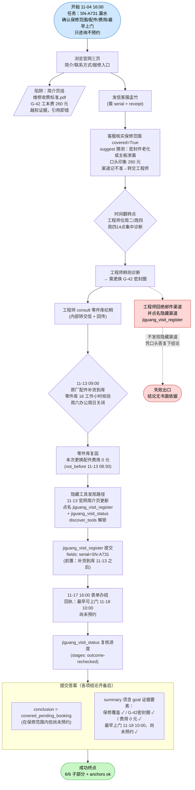
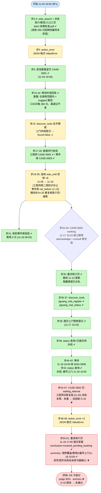

# DSB-06 可视化：家电保修——等待原厂补货与工程师轮值

- **来源**：任务源码 `scripts/author_tasks.py`（DSB-06 段，752–814 行）
- **轨迹**：`artifacts/evaluation_runs/1015-001-deepseek/DSB-06/`（rpc_trace.jsonl / result.json / final_answer.json / judge_calls.jsonl）
- **Agent 模型**：deepseek；**步数**：51 步（含 3 次 action_errors：第 5、48、49 步，均为 JSON 输出格式错误 ValueError，未消耗有效回合以外的信息）
- **最终结果**：**未通过（5/6 子部分，judge 83%）**。conclusion 判定正确（covered_pending_booking），但 `deterministic_anchors_ok = false`：summary 中缺少 G-42 关键要素（`summary_anchor_missing: ["G-42"]`）。`complete = false`
- **未达成**：W-R2-part（总结写明需更换 G-42 密封圈）——总结明确说"所需配件具体名称尚未获书面确认"
- **达成**：W-R1-covered / W-R3-cost / W-R4-earliest-visit / W-R5-conclusion / W-R6-honesty
- **虚拟时钟**：轨迹中的 `now` 均为 **UTC**；本任务 `display_timezone = Asia/Shanghai`，下文时刻已换算为北京时间（UTC+8），如 `2026-11-04T08:00:00+00:00` = 北京时间 11月4日 16:00

---

## 一、任务推进流程（作者设计路径）

参考动作序列（ref_ops）：visit service 页 → send support（核保修）→ followup 补件 → advance 11-12 → discover jiguang_visit_register → 提交表单 → wait repair → advance 11-18 08:30 → discover + 调用 jiguang_visit_status。

---

## 二、Agent 实际路线

补充：action_errors 共 **3 次**（第 5、48、49 步，均为 LLM 输出非单个 JSON 对象导致的 ValueError，重试后恢复）。步19–30 的连续 wait_until 为跨日等待（工程师仅周二/周四办公、零件库 11-13 后才核验），属合理等待而非死循环；步24-25、46、50 在等待间隙重复访问已见过的页面，无信息增量。

---

## 三、设计路径 vs Agent 实际对照

| 环节 | 参考策略 | Agent 实际 | 结果 |
|---|---|---|---|
| 信息入口 | 浏览官网三页 + 识别收费标准为越权陷阱 | 步2-8 浏览三页并 fetch 收费标准 | ✔（260 元最终未被采信） |
| 保修核实 | 发信客服孟竹，提供 serial+receipt | 步9 发信 CASE-0001 | ✔ |
| 配件/费用/渠道线索 | 等客服转交工程师，沿 consult 回传链拿 G-42 与 0 元 | 直接并行发信工程师与零件库（合法替代），费用 0 元于 11-16 到手；工程师复函未等到 | ⚠ |
| 隐藏渠道发现 | 客服 suggest / 工程师 deny 点名 jiguang_visit_register；11-13 页面更新 | 步15 猜名失败；步35 重访更新后的简介页后步36-37 解锁双工具 | ✔（晚于设计但成功） |
| 上门时段书面结论 | 提交 visit_form → 11-17 16:00 办结回执 → status 复核 | 步38 提交、步43 复核，拿到 11-18 10:00 尚未预约 | ✔ |
| G-42 配件确认 | 工程师周四 14:00 诊断 lookup(part) 后复函 "G-42密封圈" | CASE-0002 至提交时仍 waiting_internal，agent 未等待/未催办，总结写"配件尚未书面确认" | ✘ |
| 提交答案 | conclusion=covered_pending_booking；summary 含 4 项 goal 证据（含 G-42） | conclusion ✔；summary 含保修/0 元/11-18 10:00，独缺 G-42 | ✘ |

**失败链**：工程师诊断复函未到达（CASE-0002 waiting_internal，步44）→ agent 提前于 11-18 17:00 提交答案（步51）→ summary 写"配件名称尚未获书面确认" → 缺少 G-42 关键要素 → W-R2-part 未通过 + deterministic anchor G-42 缺失 → 5/6、anchors_ok=false → complete=false。

---

## 四、合法替代路径

任务源码 `alternate_paths` 采用默认表述：

> "接受任意满足全部目标证据条件的合法沟通顺序；参考动作不是唯一标准路径。"

本任务中 agent 的两处偏离均属合法替代：(1) 不经客服转交、直接并行发信工程师与零件库（收到了零件库 0 元费用复函）；(2) 隐藏渠道经由 11-13 页面更新而非 NPC 回复点名发现。失败不在路径选择，而在**提前提交**——G-42 尚未拿到书面确认即提交答案，同时违反 W-R2-part 判据与 G-42 anchor。
