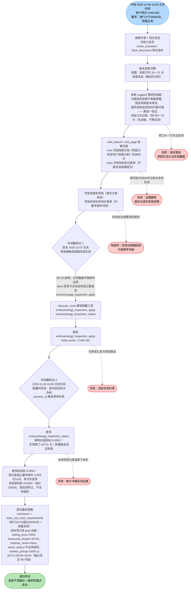

# DSB-10 可视化：二手相机：夜间联系、周末实测与取件咨询

- **任务源码**：`scripts/author_tasks.py`（DSB-10 段，中文手写题，约 1078–1140 行）
- **轨迹来源**：`artifacts/evaluation_runs/1015-001-deepseek/DSB-10/`（rpc_trace.jsonl / result.json / final_answer.json / judge_calls.jsonl）
- **Agent 模型**：deepseek；**步数**：38 步；虚拟日历跨度 2.5 天（60 小时），墙钟 224.5 秒
- **最终结果**：**未通过（complete=false）**。LLM 裁判 6/6 全过（subparts_passed=6 / subparts_total=6），conclusion 判定正确（`does_not_meet_requirements`），表单全部办结（forms_all_accepted=true），但 **deterministic_anchors_ok=false**：总结锚点缺 token `"08"`（`2026-11-09T14` 经裁判复核确认已在总结中出现，`08` 未出现），anchor_review_verdict=`judge_denied`。
- **时间说明**：虚拟时钟为 UTC，显示时区 Asia/Shanghai（+8）。下文步号标注的时刻为 rpc_trace 中的 UTC 时刻，北京时间 = UTC+8。

---

## 一、任务推进流程（作者设计路径）

## 二、Agent 实际路线

```mermaid
flowchart TD
    S(["开始 2026-11-06 02:00 UTC"]):::startNode
    S --> B1["✔ 步1-3 observe / recall_task /<br/>check_schedule卖家（确认20—22点窗口）"]
    B1 --> B2["⚠ 步4 在上午（卖家非工作时段）<br/>发信问全部问题"]
    B2 --> B3["✔ 步6 call 卖家：材料缺 serial<br/>步7 补发邮件带 serial"]
    B3 --> B4["✔ 步8 等到 11-06 12:57 UTC（20:57北京时间）<br/>收卖家 suggest：朋友/快运台 + 口头一万次"]
    B4 --> B5["✔ 步9-12 搜索并访问 intro/entry 页<br/>注意到登记表单不能直接提交<br/>（未把9800陷阱文档当实测）"]
    B5 --> B6["✔ 步13-14 并行发信：柯闻（实测）、<br/>曾澜（取件+验机，含越权询问）"]
    B6 --> B7["✔ 步19 曾澜回执 R-0001：<br/>最早取件11月9日14点、本次仅查询<br/>⚠ 未把验机报告询问当取件咨询的一部分（被回绝预期内）"]
    B7 --> B8["✔ 步20 柯闻 deny 回复点名<br/>ershoushangji_inspection_apply"]
    B8 --> B9["✔ 步21-22 discover_tools 解锁<br/>两个隐藏工具"]
    B9 --> B10["✘ 步23 请求格式错误<br/>ValueError: Return one JSON object<br/>（action_error，1次）"]
    B10 --> B11["✔ 步24 提交验机登记 serial=CAM-402<br/>回执：已提交，结果不主动推送"]
    B11 --> L1["⚠ 步25 status 查询关键词 CAM-402<br/>→ 记录为空（关键词不匹配）"]
    L1 --> B12["✔ 步26 追问卖家价格与退货政策"]
    B12 --> L2["⚠ 步29 复查 status 仍空（关键词 CAM-402）"]
    L2 --> B13["✔ 步30-32 等到 11-08 13:29 UTC<br/>收卖家正式回执 R-0003：<br/>3200元、不支持退货、口头一万次不算实测"]
    B13 --> L3["⚠ 步33 status 仍空（CAM-402）<br/>此时表单其实已于 02:00 UTC 办结"]
    L3 --> B14["✔ 步34 fetch_document 取9800陷阱文档<br/>正确地仅作参考未采信"]
    B14 --> L4["⚠ 步35 status 第4次空结果（CAM-402）"]
    L4 --> B15["✔ 步36 wait_until 11-08 14:00 UTC<br/>步37 status 不带关键词查询<br/>→ 办结回执 R-0002：快门42731、热靴失败"]
    L1 -.->|"同一无效查询 ×4<br/>步25/29/33/35（自环）"| L1
    B15 --> Z["✘ 步38 submit_answer<br/>conclusion=does_not_meet_requirements（正确）<br/>6/6 裁判子项全过<br/>但总结锚点缺字面 token 08<br/>（earliest_pickup 值 2026-11-09T14:00:00+08:00<br/>中的 08 未在总结中出现，<br/>写成 2026年11月9日14:00（北京时间））"]
    Z --> E(["未通过 complete=false<br/>judge 100% + 确定性锚点失败"]):::failNode
    classDef startNode fill:#b3d9ff,stroke:#3399ff,color:#000
    classDef successNode fill:#b6e6b6,stroke:#2e8b2e,color:#000
    classDef failNode fill:#ffcccc,stroke:#cc0000,color:#000
```

**补充说明**：
- action_errors 共 1 次，发生在步 23（请求 JSON 格式错误，重试后成功）。
- status 查询空结果（⚠ 非致命）4 次：步 25、29、33、35，均为关键词 `CAM-402` 与记录 key `验机` 不匹配；步 29、33、35 时表单实际已办结（11-08 02:00 UTC 后），第 5 次不带关键词查询（步 37）才取到办结回执——一次典型的“无效关键词自环”，多耗 4 步。
- 虚拟时刻换算：步 37 成功于 11-08 14:00 UTC = 22:00 北京时间，仍在任务截止（11-10 22:00 北京时间）内，未造成超时失败。

## 三、设计路径 vs Agent 实际对照

| 环节 | 参考策略 | Agent 实际 | 结果 |
|---|---|---|---|
| 初步联系卖家 | 20—22 点晚间窗口发信 | 上午发信（步4），窗口内才收到答复（步8）；另用电话补齐 serial | ✔ 等价达成 |
| 页面/陷阱证据收集 | 浏览 intro/entry 页，识别 9800 留存记录为陷阱 | 步9-12 完整访问三页，未采信陷阱文档 | ✔ |
| 发现隐藏登记渠道 | 从朋友 deny 回复中获得渠道名后 discover | 步20 收 deny → 步21-22 discover 两工具 | ✔ |
| 验机登记表单 | 提交 serial=CAM-402，等待 11-08 10:00 办结 | 步24 一次正确提交（中间有步23格式错误） | ✔ |
| 办结回执获取 | 办结后经 status 查询复核取得 R-0002 | 用错误关键词 CAM-402 查询 4 次皆空（步25/29/33/35），步37 无关键词查询成功 | ✔（低效） |
| 取件咨询 | 联系曾澜，取 R-0001 | 步14 发信、步19 取回执；顺带越权问验机报告（被回绝） | ✔ |
| 价格与退货 | 卖家书面回执 R-0003 | 步26 追问、步32 收回执 3200元/不支持退货 | ✔ |
| 最终结论 | does_not_meet_requirements，总结含全部 goal 证据字面 | conclusion 正确、6/6 裁判子项通过；但总结把 `+08:00` 写成“（北京时间）”，缺字面 `08` | ✘ 确定性锚点失败 |

**失败链因果**：

earliest_pickup 的 goal 值为 `2026-11-09T14:00:00+08:00` → 确定性锚点从中抽取字面 token（含日期时间前缀 `2026-11-09T14` 与 `08`）→ Agent 总结写“2026年11月9日14:00（北京时间）”→ `2026-11-09T14` 经 LLM 锚点复核判为在语义上等价出现（present=true）→ 但 `08`（来自 `+08:00` 时区偏移的字面数字）在总结中无对应字面 → anchor_review_verdict=judge_denied → summary_anchors_ok=false → deterministic_anchors_ok=false → complete=false。

即：**信息收集、隐藏工具、表单办结、结论方向全部正确，judge 6/6 全过；唯一失败点是总结对取件时间的表述缺少锚点 token `08` 的字面存在（时区偏移被改写为“北京时间”）**。这是一处表述格式与确定性锚点字面匹配之间的错位，而非流程或事实错误。

## 四、合法替代路径

任务源码 `alternate_paths` 字段（`scripts/author_tasks.py` task() 默认值）：

> 接受任意满足全部目标证据条件的合法沟通顺序；参考动作不是唯一标准路径。

即：不要求按参考策略的固定顺序（先卖家→朋友→登记→快运）。Agent 可先咨询取件、后验机登记，或先完成登记再等卖家晚间回信，只要最终 five 项 goal 证据（价格3200、实测快门42731、热靴失败、不支持退货、最早取件 2026-11-09T14:00:00+08:00）均以书面/回执形式核实并写入总结，且不付款、不让卖方保留商品、不把口头一万次或同批次9800次当实测，均按同一标准评分。本轨迹中 Agent 采用的“并行发信柯闻+曾澜、先登记后等待”的顺序即为合法替代顺序之一。
