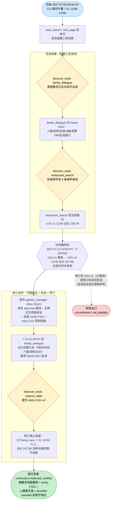
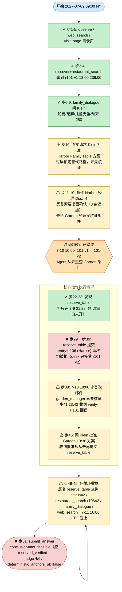

# DSB-13 可视化：Family Lunch — 无障碍通道、芝麻控制与中途变价的餐厅预订

**来源文件：** `scripts/latch_cases/dsb13_family_lunch.py`（LATCH case `food-family-lunch-001`）
**轨迹目录：** `artifacts/evaluation_runs/1015-001-deepseek/DSB-13`（rpc_trace.jsonl / result.json / final_answer.json / judge_calls.jsonl）
**Agent 模型：** deepseek
**步数：** 51 步（agent_requests 51，agent_messages 5，联系 2 位 actor）
**虚拟时钟：** 2027-07-09T09:00 美东（13:00 UTC）起，至 2027-07-11T16:00 UTC 提交；日历跨度 51 小时（2.125 天）。**注意：时钟为 UTC，任务 display_timezone 为 America/New_York，所有虚拟时刻需 -4 小时换算为本地展示时间。**

**最终结果：失败（complete=false，scored_by=judge，judge 得分 4/6 = 67%）**
- subparts_passed / subparts_total：**4 / 6**
- conclusion 判定：`conclusion_correct = false`（Agent 提交 `not_feasible`，正确结论应为 `reserved_verified`；结论标签本身合法）
- deterministic_anchors_ok：**false**（form_outcomes：processed 2 / accepted 0，`forms_all_accepted=false`；`pending_process_satisfied` 与 `pending_deadline_reached` 均为 true）
- 未通过子部分：FR1-reservation-receipt、FR4-refreshed-offer-booked

---

## 一、任务推进流程（作者设计路径）

任务：为 2027-07-11 周日安排六人家庭午餐（Riverdale test district）。需先问家人需求（隐藏 dialogue 工具）、向餐厅经理取得无障碍 + 芝麻交叉污染书面核证、盯住中途变价（7-10 10:00 后 r101-v1 撤销、r101-v2 上线）、7-10 11:00 后取得组织者批准、经隐藏预订台 `reserve_table`（expect_entry=r101-v2）提交**至多一次**预订，结论 `reserved_verified`，摘要须引用 goal 证据（地址 12 Ramp Lane、13:30、247.80、verify-F101、儿童餐无鱼、预订确认收据）。

陷阱（作者埋设）：把两间 Garden 混淆（12 Ramp Lane vs 88 Step Street）、信任目录声明而非书面核证、预订过期 13:00 报价、批准前预订、只看 sesame-free 标签不看交叉控制、把可选小费计入 280 预算。

## 二、Agent 实际路线（deepseek，51 步）

**action_errors：2 次**
- 步 29（step 28 行）：LLM 输出非 JSON，`ValueError: Return one JSON object`，重试后成功
- 步 36（step 35 行）：`call harbor_manager` 失败，`ValueError: Contact has no phone number`

---

## 三、设计路径 vs Agent 实际对照

| 环节 | 参考策略（作者设计） | Agent 实际 | 结果 |
|---|---|---|---|
| 家庭需求收集 | discover family_dialogue，问人数/无障碍/饮食/预算/批准 | 问了无障碍、饮食、预算、批准（步6-9） | ✔ 达成（FR3/FR5 证据充分） |
| 目录检索 | restaurant_search 取 r101-v1，7-10 后**重查**见 r101-v2 | 只查了 r101-v1（步4）和 Harbor r106（步16/27/33/34），**从未重查 Garden 条目**，错过变价 | ✘ 未达成（FR4 失败主因） |
| 书面核证 | 邮件 garden_manager 取 verify-F101 | 先缠 Harbor 经理 4 封邮件；7-10 18:00 才发 Garden 核证邮件，23:42 才收到 verify-F101（步41） | ⚠ 迟到但达成（FR2 通过） |
| 组织者批准 | 7-10 11:00 后出示完整 Garden r101-v2 计划求批准 | 步10 过早请求批准 Harbor；步45 才请求批准 Garden 13:30 方案，收到批准 | ⚠ 达成但太晚 |
| 预订提交 | reserve_table 提交 entry=**r101-v2**，一次成功 | 两次提交 entry=**r106**（Harbor，步29/39），均被拒；Garden 批准后**从未提交第三次** | ✘ 失败（processed 2 / accepted 0） |
| 最终答案 | conclusion=reserved_verified，摘要含收据要素 | conclusion=not_feasible，摘要称 Harbor 预订未确认、任务不可行 | ✘ FR1 未通过 |

**失败链因果：**

错过 7-10 10:00 的 Garden 报价翻新（从未重查 Garden 条目）→ 过早锁定 Harbor r106 替代路径并先行索要批准 → 两次 reserve_table 提交 r106 均被拒（预订台只接受 r101-v2）→ 核证邮件发出过晚、verify-F101 于 7-10 23:42 才到达 → 7-11 才取得 Klein 对 Garden 13:30 的批准，但**收到批准后没有再调用 reserve_table**，而是陷入查询死循环直至 7-11 16:00 UTC 截止 → 结论误判为 not_feasible → judge 4/6：FR1-reservation-receipt、FR4-refreshed-offer-booked 未通过。

值得注意的是：Agent 最终摘要中已写明 Garden Ramp 13:30 / 247.80 / verify-F101 等正确要素（FR2/FR3/FR5/FR6 均通过），只差一次 `reserve_table entry=r101-v2` 调用即可翻盘——失败不在信息收集，而在提交动作与关键换价检查的执行顺序。

---

## 四、合法替代路径

摘自任务源码 `alternate_paths` 字段：

> 对话、核证邮件与目录检索的任意合法顺序均被接受，只要每个 goal 的证据条件成立；参考路径在 7-10 变价后刷新 Garden 报价；**已核证的 Harbor Family Table 是合法替代路径**，但评分答案键以刷新后的 Garden 方案为准。

即：Harbor r106（6 Harbor Lane，13:45，259.60，verify-F106 有效至 7-11 14:00）本身是一条设计内的合法路线——但本环境的 reserve_table 预订台与 `expect_entry=r101-v2` 绑定，Agent 提交 r106 被机制拒绝；合法的 Harbor 路径评分上仍按 Garden 键判分（本案例中无论提交哪个均无法同时满足全部 subparts）。
