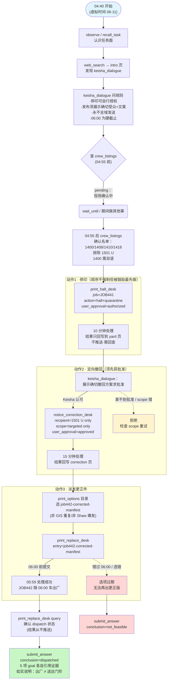
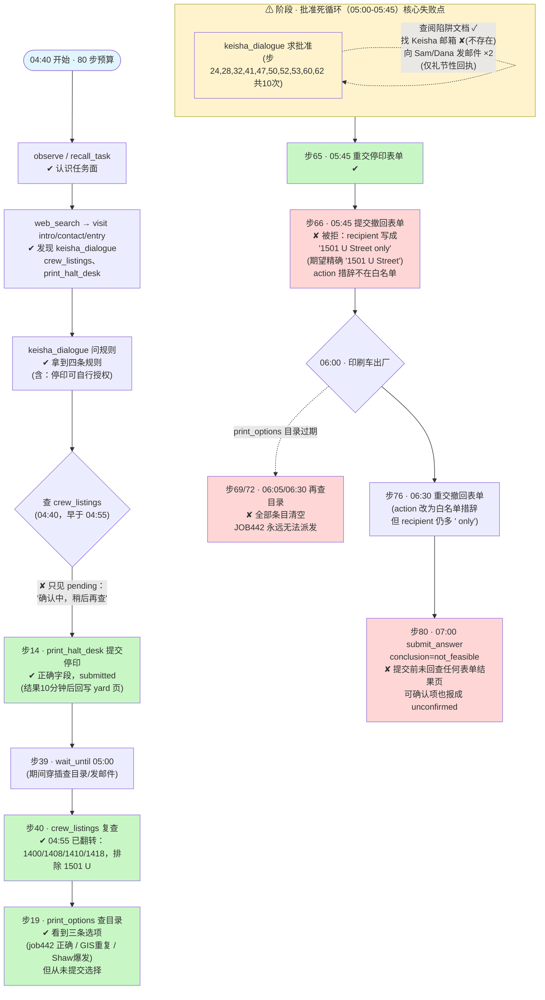

# DSB-14 可视化：任务推进流程 + Agent 实际路线

来源：`scripts/latch_cases/dsb14_outage_correction.py`（任务设计）
轨迹：`artifacts/evaluation_runs/1013-004-deepseek-rerun3/DSB-14/rpc_trace.jsonl`（deepseek-v4-flash，80 步，最终失败 3/5 goals，conclusion=not_feasible）

背景：Keisha Brown（通讯负责人）的更正流程——JOB441 昨晚把错误的停水通知投到了 1501 U Street；正确的双语门挂通知必须在 06:00 随印刷车出厂。虚拟时钟为 UTC，当地 = UTC-4，下文均换算为当地时间。

## 一、任务推进流程（作者设计路径）

## 二、Agent 实际路线（同一样式，✔ 成功 / ✘ 失误 / ⚠ 失败点）

另：全程 13 次模型输出非法 JSON（步 7/36/38/46/49/56/57/59/61/68/70/74/75），各浪费一步预算。

## 三、设计路径 vs Agent 实际对照

| 环节 | 参考策略（reference） | Agent 实际 | 结果 |
|---|---|---|---|
| 认识任务面 | visit contacts → 问 Keisha 规则 | web_search → intro → 问规则 | ✓ 等效 |
| crew 名单 | discover 后 advance 到 04:55 查 | 04:40 查到 pending，05:00 复查拿到 | ✓ 等效（多一轮） |
| 停印 JOB441 | 第一时间提交正确表单 | 04:40 提交过一次，05:45 才重交确认 | ✓ 达成 |
| Keisha 批准 | 展示确切方案一次，随后直接填 approved | 10 次求口头批准，始终不敢填 | ✗ 卡死 |
| 定向撤回 | 白名单措辞，精确 recipient | recipient 加" only"、action 自由发挥被拒 | ✗ |
| 选 JOB442 | print_options → 选 job442 | 看到过正确选项但从未提交 | ✗ |
| 派发 | 06:00 前提交 print_replace_desk | 06:00 后目录已清空 | ✗ |
| 回查结果 | advance 后 query 确认 dispatch | 提交答案前未回查任何表单结果页 | ✗ |

失败链因果：persona 永不说 yes → Agent 误以为口头批准是前置条件 → 10 次循环耗掉 05:00-05:45 → 撤回仓促提交被拒 → 拖过 06:00 目录过期 → 派发永久不可行 → 未回查即提交答案。

## 四、合法替代路径

任意顺序的「确认受众 → 停印 → 批准 → 撤回 → 派发」均可，只要每个 goal 的证据条件成立；只有 goal 证据参与评分。
