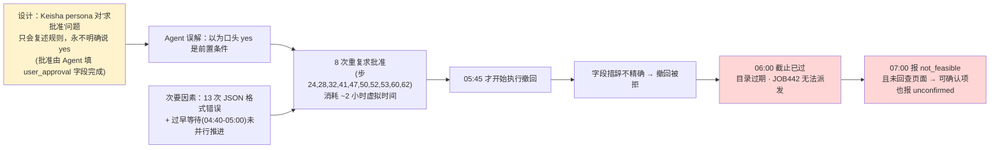

# DSB-14 Agent 实际行为可视化

数据源：`artifacts/evaluation_runs/1013-004-deepseek-rerun3/DSB-14/rpc_trace.jsonl` + `result.json`
Agent：deepseek-v4-flash · 80 步 · 结束于虚拟时间 06-11 07:00（当地）
最终结果：**失败** — resolved_success=false；goal 达成 3/5（audience ✓ bilingual ✓ halted ✓，retracted ✗ dispatched ✗）；conclusion 报 not_feasible

> 虚拟时钟为 UTC，当地 = UTC-4。下文均换算为当地时间。

## 一、行为流程图（80 步 condensed）

```mermaid
flowchart TD
    S(["04:40 开始 · 80 步预算"]) --> P1

    subgraph P1["阶段1 · 信息收集（步1-12，~04:40，全部✓）"]
        A1["observe → recall_task<br/>observe 已带 fetch_document/check_schedule"]
        A2["web_search → intro 页<br/>web_search 附带 crew_listings 服务提示"]
        A3["discover: crew_listings, keisha_dialogue, print_halt_desk<br/>visit: intro / contact / entry 页"]
        A1 --> A2 --> A3
    end

    P1 --> Q1{"查 crew_listings<br/>(04:40，早于 04:55)"}
    Q1 -->|"❌ 只见 pending：<br/>'确认中，稍后再查'"| ASK
    ASK["keisha_dialogue 问规则 → 拿到四条规则<br/>(停印可自行授权 / 发布须展示确切内容 /<br/>永不全域 / 06:00 硬截止)"] --> HALT

    HALT["步14 · print_halt_desk 提交停印<br/>✓ 正确字段，状态 submitted<br/>(结果10分钟后回写 yard 页)"] --> P2

    subgraph P2["阶段2 · 目录确认 + 批准尝试（步15-38，04:40-05:30）"]
        B1["步19 · print_options 查目录<br/>✓ 看到三条选项<br/>(job442 正确 / GIS重复 / Shaw爆发)"]
        B2["步21-23 · visit faq 页<br/>✓ 发现 notice_correction_desk"]
        B3["步24/28/32 · keisha_dialogue 求批准 ×3<br/>❗persona 只复述规则，不说 yes"]
        B4["步33/43 · 向 Sam Ortega / Dana Cole 发邮件 ×2<br/>(仅收到礼节性 acknowledgment)"]
        B1 --> B2 --> B3 --> B4
    end

    P2 --> W1["步39 · wait_until 05:00"] --> CREW2
    CREW2["步40 · crew_listings 再查<br/>✓ 04:55 翻转：拿到确认名单<br/>1400/1408/1410/1418，排除1501U"] --> P3

    subgraph P3["阶段3 · 批准死循环（步41-64，05:00-05:45）⚠ 核心失败点"]
        C1["步41/47/50/52/53/60/62<br/>keisha_dialogue 求批准再 ×7<br/>❗8 次全部得到同一句规则复述<br/>Agent 误判为'未获批准'不敢执行"]
        C2["步42/51/55 · 下载 shaw-blast /<br/>gis-2019 / reviewer-schedule.pdf<br/>（查阅陷阱文档，未误用 ✓）"]
        C3["步54 · web_search 找 Keisha 邮箱<br/>❌ 无结果（不存在邮箱）"]
        C1 --> C2 --> C3
    end

    P3 --> HALT2["步65 · 05:45 重交停印表单 ✓<br/>(第一笔此时才走完)"]
    HALT2 --> RET1["步66 · 05:45 提交撤回表单<br/>❌ 被拒：recipient 写成<br/>'1501 U Street only'(期望'1501 U Street')<br/>action 自由发挥不在白名单"]
    RET1 --> DL{"06:00 · 印刷车出厂"}

    DL -.->|"print_options 目录已过期"| DEAD["步69/72 · 06:05/06:30 再查目录<br/>❌ 全部条目清空<br/>JOB442 永远无法派发"]

    RET1 --> RET2["步76 · 06:30 重交撤回表单<br/>(action 改为白名单措辞<br/>但 recipient 仍多' only')"]
    RET2 --> ANS["步80 · 07:00 submit_answer<br/>conclusion=not_feasible<br/>retracted/dispatched 报 unconfirmed<br/>❌ 提交前未回查表单结果页"]

    style S fill:#e1f5ff
    style HALT fill:#c8f7c5
    HALT2 fill:#c8f7c5
    CREW2 fill:#c8f7c5
    style P3 fill:#fff3cd
    style RET1 fill:#ffd6d6
    style DEAD fill:#ffd6d6
    style ANS fill:#ffd6d6
```

另：全程有 **13 次模型输出非法 JSON** 的格式错误（步 7/36/38/46/49/56/57/59/61/68/70/74/75），各浪费一步预算。

## 二、失败链复盘（因果图）



## 三、设计路径 vs Agent 实际对照

| 环节 | 参考策略（reference） | Agent 实际 | 结果 |
|---|---|---|---|
| 认识任务面 | visit contacts → 问 Keisha 规则 | web_search → intro → 问规则 | ✓ 等效 |
| crew 名单 | discover 后 advance 到 04:55 查 | 04:40 查到 pending，05:00 复查拿到 | ✓ 等效（多一轮） |
| 停印 JOB441 | 第一时间提交正确表单 | 04:40 提交过一次，05:45 才重交确认 | ✓ 达成 |
| Keisha 批准 | 展示确切方案一次，随后直接填 approved | 8 次求口头批准，始终不敢填 | ✗ 卡死 |
| 定向撤回 | 白名单措辞，精确 recipient | recipient 加" only"、action 自由发挥被拒 | ✗ |
| 选 JOB442 | print_options → 选 job442 | 看到过正确选项但从未提交 | ✗ |
| 派发 | 06:00 前提交 print_replace_desk | 06:00 后目录已清空 | ✗ |
| 回查结果 | advance 后 query 确认 dispatch | 提交答案前未回查任何表单结果页 | ✗ |
