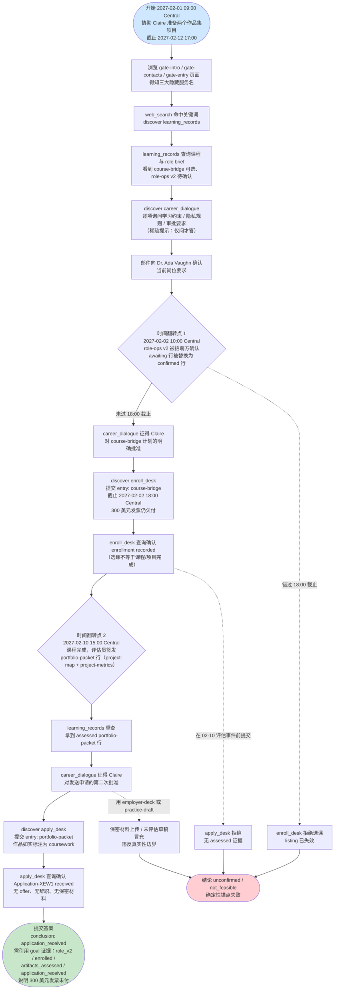

# DSB-16 可视化：Portfolio gate（评估型课程作品先于真实求职申请）

**来源文件**：`scripts/latch_cases/dsb16_portfolio_gate.py`（LATCH case `cross-education-career-portfolio-gate-001`）
**轨迹目录**：`artifacts/evaluation_runs/1015-001-deepseek/DSB-16`
**Agent 模型**：deepseek（61 步，1 次 action_error）

**最终结果（result.json）**：
- `subparts_passed: 5 / subparts_total: 5`（LLM judge 全过）
- 结论判定 `conclusion_correct: false`（agent 提交 `unconfirmed`，预期为 `application_received`）
- `deterministic_anchors_ok: false` → `complete: false`，`resolved_success: false`
- 失败原因：**judge 100% 但确定性锚点失败** —— 结论标签错误，根因是 `apply_desk` 从未以 `{entry: portfolio-packet}` 提交申请（`form_outcomes` 仅 enroll_desk 1 processed / 1 accepted；apply_desk 查询返回 `no_selection`），`application_received` 目标证据从未产生。

**时间**：虚拟时钟为 UTC（`as_of: 2027-02-12T23:00:00+00:00`）；任务 `display_timezone: America/Chicago`（Central，UTC−6），下文虚拟时刻均已换算为 Central 时间标注。

---

## 一、任务推进流程（作者设计路径）

要点：三个隐藏工具（`learning_records` catalog、`enroll_desk`/`apply_desk` select、`career_dialogue` dialogue）均经 `web_search` 关键词或页面提示后 `discover_tools` 解锁；catalog 有两次定时 update（02-02 10:00 换 confirmed v2 行、02-10 15:00 加 assessed packet 行）；decoy 行（bootcamp 超限、employer-deck 禁用、practice-draft 未评估、role-old v1 已废弃）全程在列。

---

## 二、Agent 实际路线

```mermaid
flowchart TD
    S(["开始 2027-02-01 09:00 Central<br/>step 1 observe"]) --> A1
    A1["✔ step 3-8 web_search + 浏览三页<br/>step 4 discover learning_records<br/>step 5 首查：见 course-bridge / role-ops 待确认"] --> B1
    B1["✔ step 9-11 discover career_dialogue<br/>分别问约束、隐私与审批<br/>✔ 得到 2 周/6 小时/400 美元、仅公开合成数据、<br/>两次审批要求"] --> C1
    C1["✔ step 13 征得选课批准<br/>step 14 enroll_desk entry: course-bridge<br/>（02-01 09:00 提交，远早于截止）"] --> D1
    D1["⚠ step 15 提前 discover apply_desk<br/>step 16-18 查询选课状态<br/>02-02 06:00 确认 enrollment recorded"]
    D1 --> T1{"时间翻转点 1<br/>02-02 04:00 Central v2 确认<br/>agent 于 step 19/23 重查<br/>✔ 拿到 role-ops-v2 行<br/>step 20-22 邮件确认（回复泛化）"}
    T1 --> W1["⚠ step 25-27 空等<br/>wait_until 02-03 / 02-04 / 02-09 22:00"]
    W1 --> T2{"时间翻转点 2<br/>02-10 15:00 Central packet 签发<br/>⚠ step 28-30 查询时刻为 02-09 22:00 Central<br/>早于事件，只看到 decoy 行"}
    T2 --> L1["⚠ step 34-41 反复换词查询<br/>（assessed / portfolio packet / project…）<br/>step 41 已列出 portfolio-packet 行"]
    L1 --> L2["✘ step 42 问 Claire『课程项目已完成？』<br/> persona 谨慎拒答：我尚未完成课程和项目<br/>（agent 把角色话术当作事实）"]
    L2 --> LOOP["死循环：step 43-46 换词搜<br/>completion / complete / bridge<br/>寻找不存在的『课程完成』记录<br/>×3 次共 4+ 种查询"]
    LOOP --> L3["⚠ step 47-49 第二次邮件求助评估员<br/>回复仍为泛化确认"]
    L3 --> L4["✔ step 50 查询 project<br/>结果中再次出现 portfolio-packet 行"]
    L4 --> L5["✘ step 51 问 Claire『packet 算不算完成证据？』<br/>未用 approve 字眼 → persona 回退约束规则：<br/>『请勿提交申请，等待真正的完成证据』<br/>→ 申请被角色否决"]
    L5 --> L6["✘ step 52-57 继续搜 certificate / record /<br/>course-bridge completion；step 53/54 查询<br/>enroll_desk / apply_desk → no_selection<br/>step 55-59 空等至 02-12 17:00 截止"]
    L6 --> X(["step 60 输出格式错误 1 次<br/>step 61 提交答案<br/>conclusion: unconfirmed"])
    style S fill:#cfe8ff
    style X fill:#ffcdd2
    style L2 fill:#fff3cd
    style L5 fill:#ffcdd2
    style LOOP fill:#fff3cd
```

**补充**：
- action_errors 共 1 次：step 60（agent 输出非合法 JSON，`ValueError: Return one JSON object`），step 61 改为 `submit_answer`。
- 关键转折在 step 42 与 step 51 两次 `career_dialogue` 提问：问题措辞（"课程/项目是否完成""packet 算不算证据"）命中 persona 的约束回退规则，Claire 两次明确说"尚未完成、请勿提交"；agent 因此从未调用 `apply_desk {entry: portfolio-packet}`，尽管 step 41/50 的 catalog 结果里 assessed packet 行已在眼前。

---

## 三、设计路径 vs Agent 实际对照

| 环节 | 参考策略（ref_ops） | Agent 实际 | 结果 |
|---|---|---|---|
| 了解约束/隐私/审批 | discover career_dialogue，先问三类规则 | step 9-11 逐项询问 | ✔ |
| 发现记录服务 | web_search 关键词 → discover learning_records | step 3-4 | ✔ |
| 确认岗位要求 | 02-02 更新后重查 records + 邮件确认 v2 | step 19/23 重查，role-ops-v2 行确认；邮件回复泛化 | ✔ |
| 选课审批 | 先获 Claire 对 course-bridge 精确批准 | step 13 | ✔ |
| 选课登记 | 18:00 截止前 enroll_desk entry: course-bridge | step 14（02-01 09:00 提交），step 18 确认 processed | ✔ |
| 等待评估事件 | advance 至 02-10 15:30 后重查 | wait 到 02-09 22:00 Central 即查（早于事件）→ 落空；后续换词盲搜 | ⚠ |
| 获取 assessed packet | 查询后直接以 packet 行为证据 | step 41/50 结果已含 portfolio-packet 行，但未识别为"已完成"的充分证据 | ⚠ |
| 申请前第二次审批 | 以"两个项目已评估通过，是否批准发送申请"征询 | step 42/51 两次以"课程是否完成"发问，persona 依约束规则拒绝；未用 approve 措辞 | ✘ |
| 提交申请 | apply_desk entry: portfolio-packet，再查询确认 | 仅 step 54 查询（no_selection），从未提交 | ✘ |
| 最终答案 | conclusion: application_received，引用四个 goal 证据 | conclusion: unconfirmed，如实承认申请未发出 | ✘ |

**失败链**（→）：

wait_until 目标时刻早于 02-10 15:00 Central 评估事件（step 28 只见 decoy 行）→ 换词死循环搜"completion/certificate"等不存在的行（step 43-46、52、56）→ 向 Claire 提问措辞触发 persona 谨慎回退（"尚未完成，请勿提交"，step 42/51）→ agent 把角色回退话术当作权威否决，无视 catalog 中已在眼前的 assessed portfolio-packet 行 → 从未调用 `apply_desk {entry: portfolio-packet}` → `application_received` 证据未产生 → 截止时提交 `unconfirmed` → `conclusion_correct: false` → **deterministic_anchors_ok: false**（judge 5/5 亦无法挽救，`complete: false`）。

---

## 四、合法替代路径

来自任务源码 `alternate_paths` 字段：

> "Any legal order of dialogue, record searches and provider mail is accepted if every goal's evidence conditions hold; the reference path confirms the role brief after the February 2 update, enrolls before the 18:00 deadline, and applies only after the February 10 assessment evidence exists."

（译：只要每个 goal 的证据条件成立，对话、记录检索与提供方邮件的任何合法顺序均可接受；参考路径在 2 月 2 日更新后确认岗位 brief、在 18:00 截止前完成选课、并仅在 2 月 10 日评估证据出现后才提交申请。）

即：四条证据（role_v2 确认、18:00 前的批准选课、02-10 后的 assessed packet、基于 packet 的申请提交）各自有独立的达成时刻约束，获取顺序可自由组合 —— 但 `apply_desk` 必须以 portfolio-packet 行提交且需第二次批准，这条通道不可替代。本例 agent 恰恰卡死在这最后一步。
