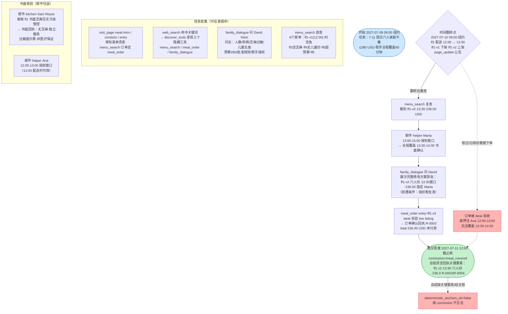
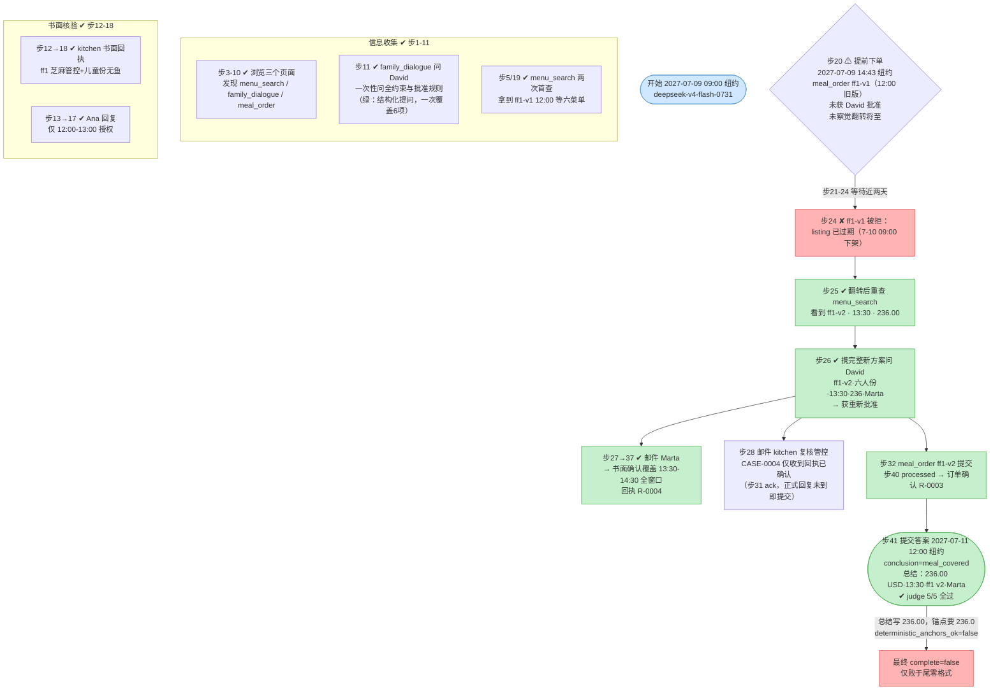

# DSB-17 可视化：家庭午餐 · 配送时间翻转后的帮手覆盖

- **任务**：DSB-17 Home family lunch: helper-covered meal after a delivery-time change（LATCH case `cross-food-family-mealtime-handoff-001`）
- **任务源码**：[scripts/latch_cases/dsb17_mealtime_handoff.py](../scripts/latch_cases/dsb17_mealtime_handoff.py)
- **轨迹来源**：`artifacts/evaluation_runs/1014-001-deepseek-retry3/DSB-17`（1014-001 抽查，前两次 run 因 simulator key-token bug 无效，修复后重跑）
- **Agent 模型**：deepseek-v4-flash-0731；**步数**：41（action_errors 0）
- **虚拟时间**：引擎时钟为 UTC，任务显示时区 America/New_York（UTC-4），下文时刻均已换算为纽约时间
- **最终结果**：❌ 未通过 —— judge 5/5 subpart 全过、结论 `meal_covered` 正确，但确定性锚点校验失败：总结缺失 `236.0`（Agent 写作 `236.00`，尾零格式不匹配）

**补充**：action_errors = 0（无非法 JSON / 非法参数）。步 22-23 两次 `wait_until` 一次跳到 7-10 12:00、一次直接跳到 7-11 10:00（跳过了 7-10 09:00 的翻转点后才发现，靠 desk 拒收兜底暴露）。

## 三、设计路径 vs Agent 实际对照

| 环节 | 参考策略（reference） | Agent 实际 | 结果 |
|---|---|---|---|
| 需求收集 | family_dialogue 一次问全 | 步11 一次问全 6 项约束 | ✓ |
| 菜单获取 | discover + menu_search 首查 | 步5/19 两次查询 | ✓ |
| 首次书面核验 | kitchen 书面芝麻管控 + Ana 窗口 | 步12-18 均拿到 | ✓ |
| 等待翻转 | 推进至 7-10 10:00 后复查看 v2 | **未等待**，7-09 14:43 即下单 ff1-v1 | ✗ |
| 组织者批准 | 批准仅对展示的完整方案生效 | 首单未获批准（踩中设计陷阱之一） | ✗ |
| 翻转后刷新 | 复查 menu_search 见 ff1-v2 | 步25 拒收后刷新，看到 v2 | ✓（被动补救） |
| 帮手覆盖匹配 | Marta 13:00-15:00 覆盖 13:30-14:30 | 步27→37 书面确认 R-0004 | ✓ |
| 重新批准 | 向 David 展示修改后完整方案 | 步26 获重新批准后才下单 | ✓ |
| 一次订单 | ff1-v2 一次成功 | 首单被拒（不构成订单）→ ff1-v2 成功 | ✓ |
| 提交答案 | 总结含回执关键要素（total 236.0） | 总结写 "236.00 USD"，`236.0` 锚点字面缺失 | ✗ |

**失败链**：未等翻转点即提前下单旧版（步20）→ desk 拒收兜底（步24）→ 被动刷新补救、后续全对（judge 5/5）→ 最终总结金额写 `236.00` 而非 `236.0` → 确定性锚点校验失败 → complete=false。

**关键发现**：
1. Agent 唯一的流程性失误是步 20 的**提前下单**——同时踩中"订旧版"与"未获批准"两个设计陷阱，但环境的时间翻转机制使其自动暴露并被拒收，Agent 随后的补救路径完全正确。
2. 最终判负点是**尾零格式**：receipt 的 `total_cost` fact 值为 `236.0`，`key_tokens` 提取锚点 `236.0`，Agent 总结写 `236.00 USD`（数字上完全正确）。边界匹配把后随数字视为 token 延续，`236.00` 无法满足 `236.0`。这是确定性层的严格性问题（金额语义等价），judge 的 5/5 与所有流程锚点实际均达成——本 case 更接近"机制误伤"而非 Agent 能力失败，值得在 scoring errata 中讨论是否按数值等价放行。

## 四、合法替代路径

任务源码 `alternate_paths`：对话、核验邮件、帮手确认与搜索的任意合法顺序均被接受，只要每个 goal 的证据条件成立；参考路径在 7-10 变更后刷新 ff1 报价并链接 Marta 的覆盖。**ff6（已验证管控、12:00 配送、268.40 USD）配 Ana 12:00-13:00 是一条合法替代路线**（不依赖翻转后刷新），但计分答案键仍按刷新后的 ff1 v2 方案。
