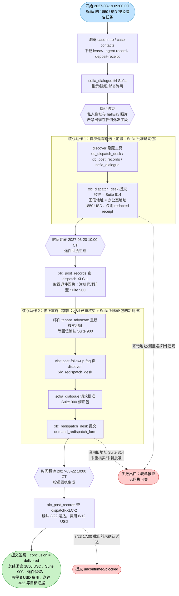

# DSB-21 可视化：Verified delivery（退件后修正重寄）

**任务来源**：`scripts/latch_cases/dsb21_verified_delivery.py`（LATCH case `cross-legal-comms-verified-delivery-001`）
**轨迹目录**：`artifacts/evaluation_runs/1015-001-deepseek/DSB-21`，agent 模型 **deepseek**
**步数**：65 步（action_errors = 0），虚拟时间跨度 2027-03-19 14:00 → 2027-03-23 22:00 UTC（约 4.3 天）
**最终结果**：**失败（complete = false）**——LLM judge 全部通过（subparts_passed 6 / 6），但确定性锚点失败：`deterministic_anchors_ok = false`，具体为 `forms_all_accepted = false`（表单 processed=3 / accepted=0）与 `conclusion_correct = false`（agent 提交 `unconfirmed`，正确结论为 `delivered`）。summary 锚点 token 齐全（3/3），answer_schema_valid = true。

> 注：虚拟时钟为 UTC；本任务 display_timezone = America/Chicago（UTC-5，工作日 9:00–17:00），如 2027-03-20T10:00:00-05:00 = UTC 15:00。

---

## 一、任务推进流程（作者设计路径）

要点：结果（退件/送达回执）只存在于事件时间之后且必须主动去 `xlc_post_records` 拉取，从不推送；两张单次提交表单各自校验"确切包"；退件第一次尝试保留在案，不可删除或覆盖。

## 二、Agent 实际路线

```mermaid
flowchart TD
    S(["开始 2027-03-19 14:00 UTC"]):::startNode

    S --> A1["✔ 步1-16: 检索+浏览+下载文件<br/>发现全部 4 个隐藏工具<br/>(步6,7,10,11 discover)"]:::okNode
    A1 --> A2["✔ 步13: sofia_dialogue 首包批准<br/>(Suite 814, 1850 USD)"]:::okNode
    A2 --> D1["⚠ 步18: xlc_dispatch_desk 提交<br/>return_address 只写 Tenant Advocacy Office<br/>(缺 attention/街道，不在 expect 列表)"]:::warnNode

    D1 --> W1["✘ 步21-26: 反复查 dispatch-XLC-1<br/>'记录尚未生成'——实际表单已被拒<br/>却从未重访 dispatch 页查看拒办结论"]:::badNode
    W1 --> W1x["死循环：wait_until + xlc_post_records<br/>XLC-1 共查 5 次(步21,23,26,54,57)"]:::badNode

    W1x --> F1["✔ 步17/34/39: 邮件 Priya 核实地址<br/>步20/46 回信确认 Suite 900"]:::okNode
    F1 --> H2["✔ 步47: sofia_dialogue 批准修正包<br/>(Suite 900, 完整办公室回信地址)"]:::okNode
    H2 --> H3["✘ 步49: 仍提交 xlc_dispatch_desk<br/>(dispatch 表)而非 xlc_redispatch_desk<br/>redispatch 表从未被处理"]:::badNode
    H3 --> H3b["✘ 步52-53: 再次向 dispatch 表重复提交<br/>(3/22-23, 同一错误)"]:::badNode

    H3b --> W2["死循环：查 dispatch-XLC-2 / XLC-3<br/>'记录尚未生成'(步59,62,63)"]:::badNode
    W2 --> Z1(["步64: 提交 unconfirmed<br/>judge 6/6 通过但锚点失败"]):::failNode

    classDef startNode fill:#bfe3ff,stroke:#5aa7d0,color:#000
    classDef okNode fill:#c9f2c7,stroke:#3f9b46,color:#000
    classDef warnNode fill:#fff2b2,stroke:#c9a227,color:#000
    classDef badNode fill:#ffcccc,stroke:#cc3333,color:#000
    classDef failNode fill:#ff9999,stroke:#aa0000,color:#000
```

**action_errors：0 次**（无工具调用错误；失败全部是流程/对象选择错误，不是参数格式错误）。

关键时间点（UTC）：步18 首次提交 03-19 14:00；步21 首查 03-19 20:33；步47 批准修正包 03-22 14:36；步49 错误重复提交 03-22 14:36；步53 再错 03-23 06:00；步64 提交答案 03-23 22:00 前。

## 三、设计路径 vs Agent 实际对照

| 环节 | 参考策略 | Agent 实际 | 结果 |
|---|---|---|---|
| 信息收集/工具发现 | 浏览页面 + discover 4 个隐藏工具 | 步1-16 全部发现，邮件核实地址 | ✔ |
| Sofia 隐私/许可确认 | 每个确切包单独问 | 步13（首包）、步47（修正包）均获批 | ✔ |
| 首次寄送 | dispatch 表，完整办公室回信地址 | 步18 回信地址过简（"Tenant Advocacy Office"），不在 expect 白名单 | ✘ 被拒 |
| 发现拒办 | 重访表单页/查状态看 reject 结论 | 从未查看，误以为"处理中"，反复查不存在的 XLC-1 记录 | ✘ |
| 地址重核实 | 查退件回执 + 邮件 Priya | 邮件三次，回信确认 Suite 900 | ✔（仅靠邮件） |
| 修正重寄 | **xlc_redispatch_desk**（redispatch 表） | 步49/53 两次都提交到 xlc_dispatch_desk | ✘ 被拒 |
| 结果拉取 | XLC-1/XLC-2 记录在事件时间后可得 | 两记录从未生成（因表单全拒），共查 8 次扑空 | ✘ |
| 最终答案 | conclusion = delivered + 全部目标证据 | conclusion = unconfirmed，总结内容本身准确 | ✘ 结论错 |

**失败链**：
步18 回信地址不合规 → 首次 dispatch 表单被拒（processed 但 accepted=0）→ agent 不查表单办结结论，误判为"等待处理" → 反复查 dispatch-XLC-1 记录扑空（记录需表单成功后才生成）→ 邮件得知 Suite 900 并获批修正包 → 步49/53 仍提交到 dispatch 桌而非 redispatch 桌 → demand_redispatch_form 从未被处理、无任何回执 → 步64 只能提交 unconfirmed → `forms_all_accepted=false` + `conclusion_correct=false` → `deterministic_anchors_ok=false` → complete=false（尽管 judge 6/6）。

## 四、合法替代路径

来自任务源码 `alternate_paths`：

> 只要每个 goal 的证据条件成立，核实、批准、寄送与结果核查的任何合法顺序均可接受；参考动作序列并非唯一有效路径。

即：不要求严格按照"首寄→退件→重核→重批→重寄"的固定顺序，只要最终满足 6 个 goal（1850 USD、Suite 900 收件、首程退件保留在案、修正程送达、两程 8 USD 费用内、仅附 redacted receipt），以及结论为 `delivered`。
