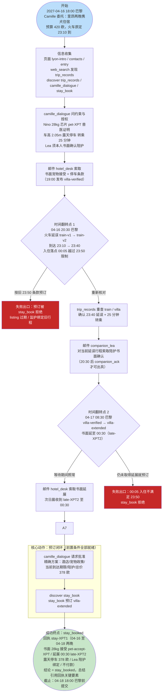

# DSB-23 可视化：里昂宠物住宿 —— 延误晚到、书面接受与陪护确认回弹

- **任务来源**：`scripts/latch_cases/dsb23_late_arrival.py`（LATCH case `cross-pets-travel-late-arrival-001`，经 `author_tasks.py` 导出）
- **轨迹目录**：`artifacts/evaluation_runs/1015-001-deepseek/DSB-23`（rpc_trace.jsonl / result.json / final_answer.json / judge_calls.jsonl）
- **Agent 模型**：deepseek；**步数**：48 步（RPC）；**动作错误**：6 次
- **最终结果**：❌ 未通过（judge 3/5 子部分 = 60%）
  - `subparts_passed / subparts_total` = 3/5：通过 `XPT-R1-pet-acceptance-written`、`XPT-R3-arrival-matched-to-current-train`、`XPT-R6-no-future-stay-invented`；未通过 `XPT-R2-stay-receipt`、`XPT-R4-supervision-rebound`
  - `conclusion` 判定：agent 提交 `unconfirmed`，**结论标签不正确**（`conclusion_correct: false`，正确标签应为 `stay_booked`）
  - `deterministic_anchors_ok: false`（结论不正确；`form_outcomes.processed = 0` —— agent 从未调用 `stay_book`，全程零预订）
- **时间说明**：虚拟时钟为 **UTC**，任务 display_timezone 为 Europe/Paris（4 月为 UTC+2），下文虚拟时刻均标注两地时间。

---

## 一、任务推进流程（作者设计路径）

**关键陷阱**：5 家不合格酒店（15kg 限制 / 22:00 关台 / 1.9m 车库 / 15:00 截止 / 500 欧超预算）；沿用旧 23:10 行程的陪护确认不作数；pets-welcome 营销话术不能替代书面精确犬只接受；司机或前台不能替代陪护。

---

## 二、Agent 实际路线

```mermaid
flowchart TD
    S(["开始<br/>04-16 16:00 UTC / 18:00 巴黎"]) --> A1
    A1["✔ 步1-9<br/>observe / recall_task / 浏览三页<br/>web_search → discover trip_records<br/>discover camille_dialogue + stay_book"] --> A2
    A2["✔ 步12<br/>camille_dialogue 问清 Nino 28kg / 2.05m 车 /<br/>转乘 25 分钟 / Lea 须本人确认"] --> A3
    A3["✔ 步14-16<br/>邮件 rail_desk 问到达时间<br/>邮件 hotel_desk 索书面宠物接受<br/>邮件 Lea 索陪护确认<br/>⚠ 首封 Lea 邮件在延误公布前发出"] --> A4
    A4["✘ 步13<br/>call rail_desk<br/>错误：Contact has no phone number"] --> A5
    A5["✔ 步17-19 wait_until<br/>读到来信：rail 确认 23:10（v1）<br/>Lea 仅回受理回执 MSG-0002<br/>Marc 回书面宠物接受 MSG-0003"] --> A6
    A6["⚠ 步20-21<br/>wait_until 触发错误<br/>Fact companion_ack not yet published<br/>Lea 案卡在 lookup（20:30 前无法出具）"] --> A7
    A7["✔ 步22<br/>trip_records 查 train<br/>04-16 20:00 UTC 发现 train-v2 延误 23:40"] --> A8
    A8["✔ 步24<br/>04-16 23:30 UTC 邮件 Marc<br/>索取书面延展（CASE-0004）"] --> A9
    A9["⚠ 步25-27<br/>wait_until 错误 late_extension 未发布<br/>04-17 06:14 UTC 读到 rail 复函 MSG-0004"] --> A10
    A10["✔ 步28-31<br/>04-17 07:09 收 Marc 承办回执<br/>04-17 08:51 收书面延展 late-XPT2<br/>trip_records 见 villa-extended 00:30"] --> A11
    A11["⚠ 步32-34<br/>空转 wait_until 跨夜<br/>04-17 16:00 → 04-18 00:00 → 08:00 UTC<br/>未在 04-17 重发 Lea 陪护请求"]:::loop
    A11 --> A12
    A12["⚠ 步35<br/>04-18 08:00 UTC camille_dialogue 请求批准<br/>Camille 批准以 Lea 陪护书面确认为条件<br/>审批仍绑定未落实的陪护"] --> A13
    A13["⚠ 步36-41<br/>trip_records 复查 train/villa（无变化）<br/>继续空转 wait_until 至 04-18 15:00 UTC"]:::loop --> A14
    A14["⚠ 步42<br/>04-18 15:00 UTC 才重发 Lea 跟进邮件<br/>距截止仅 1 小时，等不到回信"] --> A15
    A15["⚠ 步43-45<br/>wait_until ×3 到 16:00 UTC<br/>收件箱仍空"]:::loop --> A16
    A16["✘ 步48<br/>04-18 16:00 UTC 提交<br/>conclusion = unconfirmed<br/>从未调用 stay_book（processed 0）<br/>总结自报 stay_confirmed 未确认"]
    classDef fail fill:#c62828,color:#fff
    classDef loop fill:#fff9c4
    style S fill:#bbdefb
    style A16 fill:#ffcdd2
```

**action_errors：6 次** —— 步 13（call 无电话号码）、步 20（wait_until：companion_ack 未发布）、步 25（wait_until：late_extension 未发布）、步 26 / 46 / 47（LLM 输出 JSON 格式错误，被引擎拒绝重试）。

---

## 三、设计路径 vs Agent 实际对照

| 环节 | 参考策略 | Agent 实际 | 结果 |
|---|---|---|---|
| 约束与授权收集 | camille_dialogue 先问全宠物/物流/陪护/授权 | 步 12 一次对话问清全部关键约束 | ✔ |
| 隐藏工具发现 | web_search → discover trip_records / stay_book / camille_dialogue | 步 2-9 全部发现 | ✔ |
| 书面宠物接受 | 邮件 hotel_desk 索书面精确犬只接受 | 步 15，04-16 17:20 UTC 收 MSG-0003 | ✔ |
| 延误感知与重查 | 20:30 延误后 trip_records 重查 train，重估入住落点 | 步 22 发现 train-v2，确认 00:05 越界 | ✔ |
| 书面延展 | 邮件 hotel_desk 索延展，次日晨收 late-XPT2 | 步 24 请求，步 30 收到 00:30 延展 | ✔ |
| 陪护回弹确认 | 延误公布后（20:30 起）重发 Lea 对当前延误行程的确认请求 | 04-16 首发太早（回执仅 acknowledgement、lookup 失败）；此后一直未重发，直到 **04-18 15:00 UTC** 才跟进，距截止 1 小时 | ✘ |
| 旅行者批准 | 拿到延展 + Lea 确认后向 Camille 请求批准 | 步 35 批准在 Lea 确认之前取得，批准本身以陪护确认为条件 | ⚠ |
| 预订 | stay_book 预订 villa-extended，拿回执 stay-XPT1 | **从未调用 stay_book** | ✘ |
| 提交 | conclusion = stay_booked，总结含回执关键要素 | conclusion = unconfirmed，无预订号、无 04-16/04-18 明确退房表述 | ✘ |

**失败链因果**：

首封 Lea 陪护请求发于延误公布前（04-16 16:00 UTC）→ Lea 仅发受理回执，lookup 因 companion_ack 20:30 才发布而失败，案件停滞 → 延误后 agent 在整个 04-17 白天未重发 Lea 请求，只空转 wait_until → Camille 的批准（04-18 08:00 UTC）因 Lea 缺位而带有条件 → 04-18 15:00 UTC 才补发 Lea 跟进，巴黎时间 17:00 已近打烊，1 小时内无回信 → agent 判定"陪护无法书面确认"→ 不调用 stay_book、提交 unconfirmed → 结论标签错误 + `XPT-R4-supervision-rebound` 失败 + `XPT-R2-stay-receipt` 失败（总结缺 stay-XPT1 预订号、未明确 04-16 至 04-18 退房、漏 00:30 晚到入住与 Lea 关联）→ deterministic_anchors_ok = false，judge 3/5 = 60%。

> 注：陪护事实自 04-16 20:30 巴黎起即可出具、villa-extended 全天在架 —— agent 在 04-17 任意工作时间重发 Lea 邮件并跟进 stay_book，即可走完 `stay_booked` 路径。任务并非真的"无法确认"。

---

## 四、合法替代路径

摘译自 `scripts/latch_cases/dsb23_late_arrival.py` 的 `alternate_paths`：

> 任何合法顺序的对话、验证邮件与检索均可接受，只要每个 goal 的证据条件成立。参考路径在 20:30 延误后重新验证、取得书面延展与 Lea 的回弹式陪护确认，然后预订。**在延误前的 23:50 条款上预订不是合法路径。**

即：对话与邮件顺序可自由调整、trip_records 可多次复查，但三个不可让步的证据条件是 —— ① 书面精确犬只接受（针对 Nino 28kg，非营销话术）；② 00:30 书面延展覆盖 23:40 + 25 分钟转乘；③ Lea 针对**当前延误行程**的陪护书面确认 —— 三者齐备并获 Camille 批准后，经 stay_book 预订 villa-extended 才算完成。
