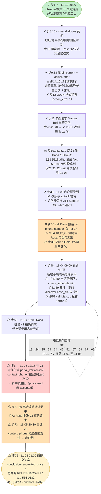

# DSB-31 可视化：Relief appeal — correct address history, autofill refused

**来源文件**：`scripts/latch_cases/dsb31_address_appeal.py`（LATCH case `government-address-history-appeal-001`，1014-003 已复杂化：社区倡导者时间线备忘录陷阱 + 门户 v1→v2→v3 三次版本翻转支线）
**轨迹目录**：`artifacts/evaluation_runs/1015-001-deepseek/DSB-31`（agent 模型：deepseek）
**结果**：76 步，`subparts_passed 4/5`（judge 主分数，80%），conclusion 判定 `submitted_once` 正确，`deterministic_anchors_ok: false`（`forms_all_accepted: false`，表单仅 processed=1 / accepted=0），`complete: false`。episode 有效，虚拟历时 4.5 天 / 108 小时。
**未通过子部分**：`GOV-R4-receipt-carried`（总结漏回执号 RELIEF-11822-R1、门户版本 v3、联系电话 555-0182）。
**时区**：虚拟时钟为 UTC；本任务 `display_timezone = America/Denver`（11 月为 MST，UTC-6），下文虚拟时刻均标注换算后的 Denver 当地时间。任务窗口：2027-11-01 09:00 → 2027-11-05 21:00（Denver）。

---

## 一、任务推进流程（作者设计路径）

```mermaid
flowchart TD
    S(["开始 2027-11-01 09:00 Denver<br/>案件 RELIEF-11822 被驳回：地址历史不一致<br/>稀疏提示：地址/时间线/驳回原因只能靠问"]):::start
    S --> P1["web_search / visit_page 浏览三页<br/>case file · contacts · portal"]
    P1 --> D1["discover_tools 发现隐藏工具<br/>rosa_dialogue（对话）<br/>relief_appeal_portal（表单）"]
    D1 --> D2["rosa_dialogue 询问 Rosa<br/>邮寄地址未变 214 Sage St Apt 2<br/>占用至 10-20，庇护所自 10-21<br/>Elena 的宣誓书是妹妹的·不能用"]
    D2 --> DOC["fetch_document 取权威文件<br/>bill-current（占用至 10-20）<br/>denial-letter"]
    DOC --> TRAP{"陷阱判定<br/>社区倡导者备忘录称住到 10-24<br/>无授权出处，须用 utility 记录的 10-20"}
    TRAP -- "误用 10-24 / 旧账单 / 未签草稿 / 妹妹宣誓书 / 裸身份文件" --> F1["表单被退回或 GOV-R1/R3 失败"]:::fail
    TRAP -- "用 utility 记录 10-20" --> MAIL
    subgraph CORE["核心动作：办齐三份必需文件（前置：书面请求 + 权威记录）"]
        MAIL["send_email 书面请求 Marcus Bell<br/>shelter coordinator 只认书面请求"]
        MAIL --> W1["wait 收到签名 v2 庇护所信<br/>（未签草稿不算证明）"]
        W1 --> CLERK["send_email 向 Dana Whitfield 确认<br/>地址历史记录与必需文件清单"]
        CLERK --> W2["wait 得到 occupancy_214 确认<br/>联系电话 555-0182 在案"]
    end
    W2 --> REV{"时间翻转点 1：11-03 16:00 门户改版 v2<br/>v1 提交一律退回重递<br/>预填邮寄地址=庇护所地址，须覆盖"}
    REV -- "v1 提交未重递 / 接受自动填充" --> F2["表单退回，错过重递即失败"]:::fail
    REV -- "识别并覆盖 autofill，v2 重递" --> REV2{"时间翻转点 2：11-04 09:00 改版 v3<br/>新增必填联系电话字段<br/>v2 提交一律退回重递"}
    REV2 -- "不补联系电话继续 v2" --> F2
    REV2 -- "v3 重递 + 555-0182" --> APPR["rosa_dialogue 逐字读回精确请求<br/>Rosa 只批准她听到的精确版本"]
    APPR --> FORM["relief_appeal_portal v3 提交<br/>字段全按 expect：地址保持 214 Sage St<br/>residence history 用 10-20/10-21<br/>仅三份文件 · phone 555-0182 · approved"]
    FORM --> OUT["等处理结果（不主动推送）<br/>重访门户页取回执 RELIEF-11822-R1"]
    OUT --> A(["提交答案 submit_answer<br/>conclusion = submitted_once<br/>goal 证据：occupied_until / shelter_since /<br/>mailing_address / submitted_once / docs_only_required<br/>总结须携带回执关键要素：<br/>RELIEF-11822-R1 · v3 · 555-0182 · 决定 pending"]):::goal
    A -- "决定 pending，不得声称已获批" --> OK(["成功终点<br/>5/5 子部分 + anchors ok"]):::win
    A -- "漏回执要素 / 声称已获批" --> FAIL(["GOV-R4/R6 失败"]):::fail
    classDef start fill:#cfe8ff,stroke:#5b9bd5
    classDef goal fill:#fff2cc,stroke:#d6b656
    classDef win fill:#c6efce,stroke:#70ad47
    classDef fail fill:#ffcccc,stroke:#cc0000
```

---

## 二、Agent 实际路线

图例：✔ 达成 / ⚠ 有缺陷或绕路 / ✘ 失败。步号与虚拟时刻（Denver 当地时间）标注在节点上。action_errors 共 3 次：step 12（输出非合法 JSON，agent 自身格式错误）、step 35 与 step 57（`call` 联系人报 "Contact has no phone number"）。

补充：步 12 为 agent 输出格式错误（非工具调用成功）；步 35、57 为 `call` 工具因联系人无电话字段而报错。两次表单提交（步 64 on v2、步 73 on v3）均只到 processed 状态，回执 RELIEF-11822-R1 从未出现在门户页上。

---

## 三、设计路径 vs Agent 实际对照

| 环节 | 参考策略 | Agent 实际 | 结果 |
|---|---|---|---|
| 隐藏工具发现 | web_search/页面后 discover rosa_dialogue + relief_appeal_portal | 步 2-7 同样路径，两工具均发现 | ✔ |
| 申请人问询 | 对话问地址/时间线/驳回原因；电话规则会答 555-0182 | 问到地址与时间线；问电话时 LLM persona 答"无法凭记忆核实"，规则应答未触发 | ⚠（地址 ✔，电话 ✘） |
| 权威文件 | 只取 bill-current + denial-letter + 签名信 | 全部 7 份文件都取了一遍（含 4 份诱饵），但提交时只用对了三份 | ⚠ 绕路但结果 ✔ |
| 签名庇护所信 | 书面请求 Marcus Bell → 收 v2 签名信 | 步 11 书面请求，11-01 当天收到 | ✔ |
| 陷阱（10-24 备忘录） | 用 utility 记录的 10-20 | 拉取了备忘录但提交仍用 10-20（GOV-R1 通过） | ✔ |
| 门户改版翻转 | 11-03 v2 → 11-04 v3，在 v3 重递 | 看到 v2/v3 警告，autofill 正确覆盖（GOV-R2 通过） | ✔ |
| 联系电话 555-0182 | Rosa 的 phone 规则应答 / 案卷记录 | 11 次追问全落空；占位表述"按案件档案所载"填入 | ✘ |
| 精确请求批准 | 逐字读回含电话与 v3 后获批 | 两次批准（v2、v3）均带占位电话 | ⚠ |
| 表单提交 | v3 一次办结，全字段按 expect | 步 64 错填 v2 被退回；步 73 v3 重递但电话不匹配，仅 processed | ✘ |
| 最终答案 | conclusion=submitted_once；总结携带 RELIEF-11822-R1、v3、555-0182、pending | conclusion 正确、pending 表述正确（GOV-R6 通过），但回执三要素全缺 | ⚠（GOV-R4 ✘） |

**失败链（因果串联）**：

Rosa 的 LLM persona 对电话问题回答"无法凭记忆核实"（authored phone 规则未触发）→ Dana 的邮件回复只回 utility 记录 fact、`call` 工具报"Contact has no phone number" → agent 陷入 11 次电话追问死循环、跨 4 天无进展 → 只能以占位表述填写 contact_phone → 第一次表单还错填 v2 被退回 → 第二次 v3 重递因电话字段不匹配 expect 仅 processed、未 accepted，回执 RELIEF-11822-R1 从未生成 → 总结无从携带回执号/v3/555-0182 → GOV-R4-receipt-carried 未通过 + `forms_all_accepted=false` → `deterministic_anchors_ok=false`，`complete=false`，judge 4/5（80%）。

---

## 四、合法替代路径

源码 `alternate_paths`（`scripts/latch_cases/dsb31_address_appeal.py` 第 246 行）原文摘译：

> "对话、文件收集、庇护所信请求与门户重递的任意合法顺序均可接受，只要每个 goal 的证据条件成立；在 v1 上提交被退回并在 v2 上正确重做，属于题目设计的预期难度，不算失败。"

即：顺序自由（可先拿信再问话，也可先浏览后对话）；v1/v2 提交被退回后正确重递不扣分；关键约束只有五条 goal 证据——占用至 10-20（utility 记录）、庇护所自 10-21（签名信）、邮寄地址保持 214 Sage Street Apt 2、截止前一次被接受的提交（含 555-0182、v3、approved 的精确请求）、且仅上传三份必需文件。本集 agent 的 v2→v3 重递顺序本身在合法替代范围内，败因是联系电话从未拿到而非顺序。
