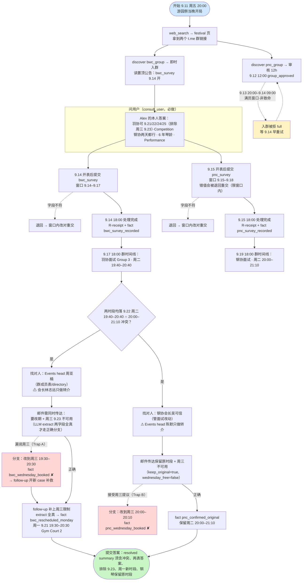
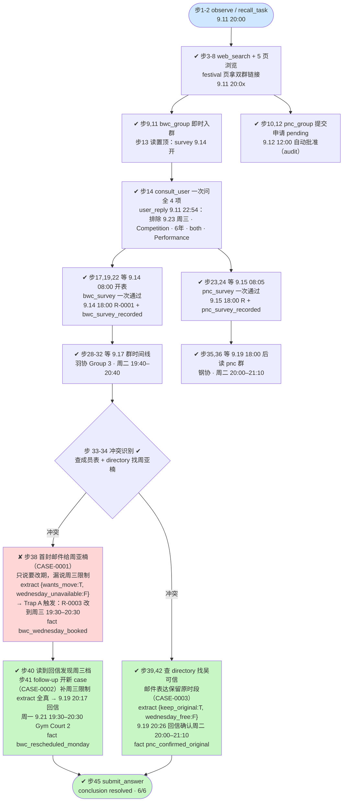

# DSB-43 可视化 — Club recruitment: two app groups, staggered surveys, one interview clash

- 任务源码：`scripts/club_cases/dsb43_club_recruitment.py`（club_cases 管线，v0.5 范式）
- Agent 轨迹：`artifacts/evaluation_runs/1024-043-rerun2/DSB-43`（deepseek-v4-flash，45 步，action_errors 1 次）
- 最终结果：**judge 6/6 subparts，deterministic_anchors_ok = True，complete = True，conclusion = resolved**
- 时区说明：虚拟时钟为 UTC；任务 `display_timezone` 为 Asia/Shanghai（UTC+8），下文时刻均已换算为北京时间

---

## 一、任务推进流程（作者设计路径）

设计要点：一周三小时群是独立 app 服务（浏览器不能入群）；问卷时间窗 9.14–9.17 / 9.15–9.18 在表单工具层强制执行；extract 受助人分支只匹配 LLM 提取的结构化字段，绝无关键词判定。

## 二、Agent 实际路线（1024-043-rerun2，45 步）

与第一节同款样式，✔ 成功绿底 / ⚠ 卡点黄底 / ✘ 失误红底，步号为 rpc_trace 步号：

- **action_errors：1 次**（步 37，非法 JSON，下一个动作步 38 正常恢复）
- 群容量满员窗口（9.13 20:00–9.14 09:00）本 run 未被踩中（agent 9.11 已入群）
- 与上一轮（1024-043-deepseek 修复版）相比：本轮 agent 在 9.15 当天即正确提交钢协问卷，未触发退回路径；但 Trap A 真实触发并经 follow-up 恢复，验证了陷阱分支 + follow-up 新 case 二次 extract 的完整链路

## 三、设计路径 vs Agent 实际对照

| 环节 | 参考策略（reference） | Agent 实际 | 结果 |
|---|---|---|---|
| 入口信息 | festival 页拿双群链接 | 步 3–8 同路径 | ✓ |
| 入群 | bwc 即时 / pnc 审核 12h | 步 9–12，9.12 12:00 批准 | ✓ |
| 问用户 | consult_user 两次（问卷前 + 冲突后） | 步 14 一次问全，冲突后未再问（已有答案，可接受） | ✓ |
| bwc 问卷 | 9.14 开表提交，排除周三 | 步 22 一次通过，R-0001 | ✓ |
| pnc 问卷 | 9.15 开表提交 both/6 年/Performance | 步 24 一次通过（上轮曾退回重交，本轮无） | ✓ |
| 排班读取 | 9.17 / 9.19 后读群时间线 | 步 28–32 / 35–36 | ✓ |
| 找对人 | 周亚楠（改期）/ 吴可信（确认）；避开会长转介 | 群成员表 + directory，未踩转介陷阱 | ✓ |
| 羽协改期邮件 | 一次传达 wants_move + 周三限制 | 步 38 漏周三 → Trap A（R-0003 周三档）；步 41 follow-up 补救 | ⚠→✓ |
| 钢协确认 | 保留原时段、拒绝周三提议 | 步 42 一次到位，pnc_confirmed_original | ✓ |
| 提交答案 | resolved + 完整 summary | 步 45，judge 6/6 | ✓ |

失败链（本 run 唯一失误）：首封羽协邮件漏传达周三限制 → extract 走陷阱分支 → `bwc_wednesday_booked`（周三 19:30–20:30 面试）→ agent 读回信发现与排练冲突 → follow-up 开新 case 补充限制 → 二次 extract 命中正确分支 → `bwc_rescheduled_monday`。**失误被 follow-up 路由机制兜住，未影响最终判定。**

## 四、合法替代路径

摘自 `alternate_paths`：任意合法顺序的入群、问卷提交、时间线读取与负责人邮件均被接受，只要每个 goal 的证据条件成立；两个俱乐部可任意先后处理；冲突也可以通过把羽协面试改到用户实际有空的其他晚上解决——参考策略的周一时段只是其中一个合法结果，不是唯一解。
