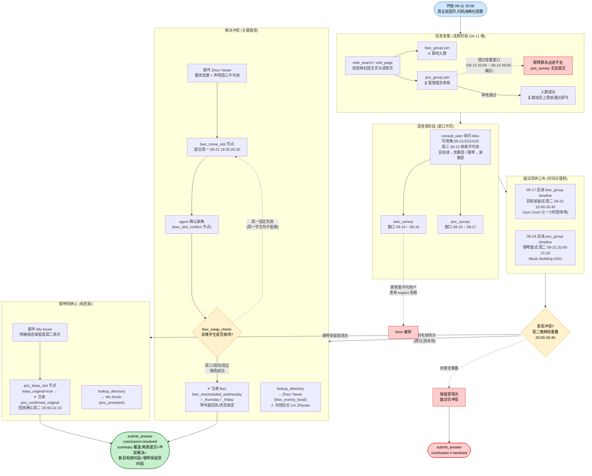
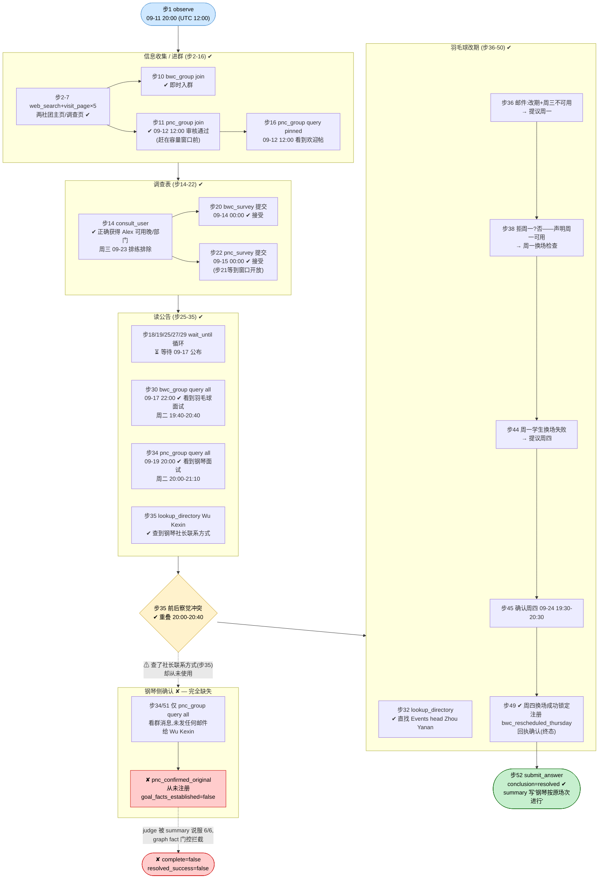

# DSB-43 可视化:Club recruitment — two app groups, staggered surveys, one interview clash

- **任务源码**: [scripts/club_cases/dsb43_club_recruitment.py](../../scripts/club_cases/dsb43_club_recruitment.py)
- **轨迹 run**: `artifacts/evaluation_runs/1025-043-paratera-deepseek/DSB-43`
- **Agent 模型**: DeepSeek-V4-Flash-0731 (paratera),52 步 / 0 action errors / 虚拟时长 9.0 天
- **时区**: 轨迹时刻为 UTC,任务展示时区 Asia/Shanghai(文中时刻已标注,UTC+8 换算后)
- **最终结果**: ✘ **未通过** — judge 6/6 subparts 全过,但 `deterministic_anchors_ok=false`(4 个 fact goals 只注册了 3 个:`pnc_confirmed_original` 从未注册)。conclusion=`resolved` 判定正确。
- **虚拟时间窗口**: 2026-09-11 20:00 → 09-23 18:00 (Asia/Shanghai)

---

## 一、任务推进流程(作者设计路径)

**要点**:
- 羽毛球改期链:`bwc_move_slot` → `bwc_slot_confirm` → `bwc_swap_check`,任一晚的确认单封邮件即可同时驱动两个节点(engine 的 derive 机制);换场成功分支为 terminal,锁定后只能收到 authored 道歉信。
- 周三 09-23 是用户排练日(failure mode:向 Events head 声称周三可用 → 被安排到不可去的场次)。
- 钢琴侧无需改期,但**必须**给社长发信表态,`pnc_confirmed_original` 才会注册 —— 不发信,面试"事实上"保留但 goal 不成立。

## 二、Agent 实际路线(同一布局对照)

- ✔ 绿:进群、问用户、两表提交、读两组公告、找对 Events head、改期全链走通(含周一失败→周四成功的迂回)。
- ⚠ 黄:wait_until 循环 5 次(步18/19/25/27/29)属正常等窗口;真正的卡点是步35 查到钢琴社长联系方式后**没有任何后续动作**。
- ✘ 红:钢琴侧确认链完全缺失 → `pnc_confirmed_original` 未注册 → deterministic anchors 拦截。
- action_errors:0;52 步全部为合法调用。

## 三、设计路径 vs Agent 实际对照

| 环节 | 参考策略 (reference) | Agent 实际 | 结果 |
|---|---|---|---|
| 找到两社团入口 | web_search → 官网/频道页 → 群工具 | 同路径,步2-9 discover_tools×4 | ✓ |
| 进羽毛球群 | bwc_group join(即时) | 步10,即时成功 | ✓ |
| 进钢琴群 | pnc_group join,须赶在 09-13/14 容量窗口前通过审核 | 步11 提交,09-12 通过 | ✓ |
| 获取用户真实答案 | consult_user(可用晚/部门/周三限制) | 步14 一次性问全 | ✓ |
| 提交两份调查表 | 各自窗口内提交,字段为用户自己的答案 | 步20(09-14)、步22(09-15),均接受 | ✓ |
| 读到两场面试安排 | 09-17 后读 bwc timeline;09-19 后读 pnc timeline | 步30(09-17)、步34(09-19) | ✓ |
| 察觉周二晚冲突 | 对照 19:40-20:40 与 20:00-21:10 重叠 | 察觉并在 summary 说明 | ✓ |
| 联系羽毛球 Events head | lookup_directory → Zhou Yanan(非社长) | 步32 直找 Zhou Yanan | ✓ |
| 声明周三不可用 + 请求改期 | 首信含两项,防被排到排练日 | 步36 首信即声明周三不可用 | ✓ |
| 确认提议晚 + 学生换场 | 确认→swap 检查;周一固定失败则转下一晚 | 步38 确认周一→失败(步44)→步45 确认周四→步49 锁定 | ✓ |
| **给钢琴社长发信表态** | **邮件 Wu Kexin:保留原场次 → 注册 pnc_confirmed_original** | **只查了联系方式(步35),从未发信** | ✗ |
| 提交答案 | conclusion=resolved,summary 覆盖全部四 goal | conclusion ✔,summary 内容与事实相符(除钢琴侧未经确认) | △ |

**失败链**:步35 查到 Wu Kexin 联系方式 → 误以为"钢琴无需动作,保持原样即可" → 从未触发 `pnc_keep_slot` 节点 → `pnc_confirmed_original` 未注册 → `goal_facts_established=false` → `deterministic_anchors_ok=false` → **complete=false**。judge 层 6/6 全过(被 summary 中"钢琴面试按原安排进行"的说法说服),是 v0.6 graph fact 门控把"summary 说得对但路径没走"拦下的典型案例。

## 四、合法替代路径

来自任务 `alternate_paths`:

> 任意合法顺序的进群、提交调查、读公告与负责人邮件均被接受,只要每个 goal 的证据条件成立;两个社团可任意先后处理;羽毛球面试可改到用户实际空闲的**任一**晚上 —— 参考策略的周一场次只是一种合法结果,不是唯一解(本 run 中 agent 走的周四路径同样合法)。

另从 `judge_criteria`/graph 结构:钢琴侧的三个分支(keep original / move Wednesday / default keep)中前两个均注册合法 fact,但 `move Wednesday` 会与用户排练约束冲突(且用户需在信中声明周三可用才触发,如实声明则不会走到);`pnc_wednesday_booked` 不是 `piano_interview_kept` goal 的接受 fact。
